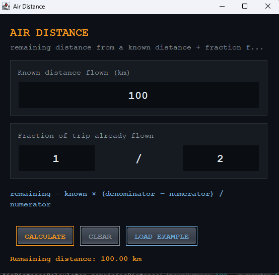

# Air Distance

> Compute remaining distance from a known distance already flown and the fraction of the trip it represents.




If you've flown 100 km and that represents half the trip, you have 100 km
to go. If you've flown 50 km and that's three quarters, you have 16.67 km
left. This tool does that arithmetic — nothing more, nothing less — with
a Swing front end and a fully tested pure-math core.

## Formula

```
remaining = knownDistance × (denominator − numerator) / numerator
```

Derived from:

```
fraction  = numerator / denominator       (portion of the trip flown so far)
total     = knownDistance / fraction
remaining = total − knownDistance
```

Both forms are algebraically identical. The simplified one is what's
implemented, because it avoids an intermediate division and reads
cleaner.

## Features

- Three fields: known distance, numerator, denominator
- Input validation with specific error messages (which field is bad, and why)
- `numerator = 0` and `denominator = 0` both rejected with clear explanations
- Locale-independent number formatting (`100.00`, never `100,00`)
- 12 unit tests covering normal, edge, and error cases
- Zero runtime dependencies

## Tech

Java 21 · Swing · JUnit 5 · Maven · zero runtime dependencies

## The two-class split

```
AirDistanceCalculator    — pure math, no Swing, no I/O
AirDistanceApp           — Swing UI, input parsing, error display
```

`AirDistanceCalculator` has no imports from `javax.swing` or `java.awt`,
which is why the tests run headless in a fraction of a second. This is
the same separation the rest of the repo uses: `ChatServer` has no
JavaFX, `BoardModel` has no Swing, `QuizEngine` has no Swing. The rule is
consistent — pure logic never knows about the toolkit that drives it.

## Run it

**From a release** (needs Java 21+ only):

```bash
java -jar air-distance-1.0.0.jar
```

[Releases page](https://github.com/vbforge/java-desktop-labs/releases/tag/air-distance-v1.0.0)

Same jar works on every platform.

**From source** (needs JDK 21 and Maven):

```bash
cd apps/air-distance
mvn clean compile exec:java
```

**Run the tests only:**

```bash
mvn test
```

**Build a jar:**

```bash
mvn clean package
# → target/air-distance-1.0.0.jar
```

## Using it

1. Enter the known distance already flown (km).
2. Enter the fraction of the trip already flown, as `numerator / denominator`.
3. Click **CALCULATE**. The remaining distance appears below the buttons.
4. **LOAD EXAMPLE** fills in `100, 1, 2` — expected result `100.00 km`.
5. **CLEAR** resets all fields.

## A note on the original test-cases.md

Six of the seven original example rows check out exactly:

| Known | Num | Den | Remaining |
|-------|-----|-----|-----------|
| 100   | 1   | 2   | 100.00    |
| 50    | 3   | 4   | 16.67     |
| 200   | 2   | 5   | 300.00    |
| 150   | 1   | 3   | 300.00    |
| 0     | 1   | 2   | 0.00      |
| 100   | 1   | 1   | 0.00      |

One row — `known=100, numerator=0, denominator=1 → "-100.00"` — does not
follow from this or any formula consistent with the other six.
`numerator=0` means "0 of the trip has been flown", which contradicts a
known distance of 100 and is mathematically undefined. This implementation
treats `numerator = 0` as a validation error, same as `denominator = 0`,
rather than silently producing `Infinity`.

## What I learned

- **A spec is a claim, not an oracle.** The original `test-cases.md`
  contained one row that couldn't be reconciled with the other six. The
  right response wasn't to hack the code until it passed, and it wasn't
  to silently ignore the row — it was to work out what the row *should*
  say, document the reasoning, and treat the input as invalid. Every
  test suite needs someone willing to ask "is this expected value
  actually correct?"

- **`String.format(Locale.US, "%.2f", x)` is not optional.** Under a
  German or French locale, `%.2f` prints `100,00` with a comma. Any
  program that formats numbers for a machine or for an international
  audience must pass an explicit locale, or it will produce different
  output on the developer's machine than on the user's.

- **Splitting pure math from UI makes tests trivial.** With the
  calculation logic in a separate stateless class, testing it takes
  milliseconds and no display. The same code inside the JFrame would
  need a headless AWT environment and would be ten times slower. The
  split costs one file and pays for itself the first time you refactor.

- **A utility class is `final` with a private constructor.** Every
  method on `AirDistanceCalculator` is static and pure. There's no
  reason for anyone to instantiate it. The private constructor makes
  that impossible at compile time, not just at runtime.

- **Nimbus is the right LAF for a dark Swing theme.** The Windows
  system LAF paints its own chrome and silently ignores most
  `UIManager` colour keys — text fields stay white with white text,
  dropdowns ignore `foreground`. Nimbus is fully themable through
  the same keys. Every Swing app in this repo uses it for that
  reason.

- **`@ParameterizedTest` beats four copy-pasted methods.** Four
  normal-case tests collapse to four rows in a `@CsvSource`. Adding a
  fifth case is a single line of data, and a reader sees a table of
  input/output pairs rather than boilerplate. Worth the import.

## License

MIT — see [LICENSE](../../LICENSE).