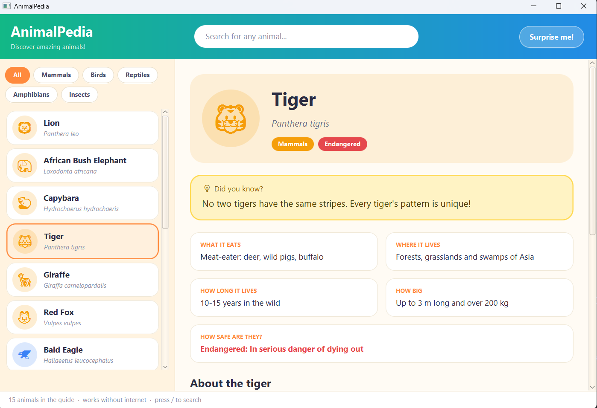

# AnimalPedia

A friendly desktop encyclopedia of animals for curious kids, built with **Java 21** and **JavaFX 21**.




- 15 hand-written animal guides that work **offline**: lions, elephants, penguins, axolotls and more
- Each animal has a "Did you know?" fun fact, quick facts (what it eats, where it lives, how long it lives,
  how big, how safe it is) and a family tree
- Search any animal in the world: type a name and results from Wikipedia appear under the built-in animals
- Everything fetched from Wikipedia is saved on disk, so a second visit is instant and works offline
- "Surprise me!" button picks a random animal

## Run it

You need JDK 21 and Maven.

```
mvn javafx:run
```

## Build one runnable jar

```
mvn clean verify
java -jar target/animalpedia-1.0.0-all.jar
```

The jar contains the JavaFX libraries for the operating system you build on, so build on Windows for a
Windows jar, on macOS for a macOS jar, and so on.

## Keyboard shortcuts

| Key | What it does |
|---|---|
| `/` or `Ctrl+F` | Jump to the search box |
| `Enter` (in search) | Open the first result |
| `Down` (in search) | Move into the list |
| `Up` / `Down`, `Enter` (in list) | Move through the list and open an animal |
| `Esc` | Clear the search (or leave it) |
| `Ctrl+R` | Refresh the current Wikipedia article |
| `F11` | Full screen |

## How it works

```
com.vbforge.animalpedia
  model/    Animal, Taxonomy, ConservationStatus, DataSource   (plain Java records and enums)
  engine/   Catalog, WikipediaClient, ArticleCache, AnimalRepository, ArticleFormatter
  ui/       Theme, ArticleView                                  (JavaFX)
  AnimalPediaApp.java                                           (window, search, list, shortcuts)
```

- `model/` and `engine/` do not use JavaFX, so all their tests run without a screen or internet.
- **Order of lookup:** built-in guide, then a fresh saved copy, then Wikipedia, and finally an older saved copy
  if Wikipedia can't be reached.
- **Cache:** `~/.animalpedia/cache/<name>.json`, valid for 7 days. Delete the folder to clear it.
- **Wikipedia calls:** `opensearch` for search and `rest_v1/page/summary` for articles, with the header
  `User-Agent: AnimalPedia/1.0`. Disambiguation pages and pages without text show a friendly message.
- **Emoji:** drawn when the computer has an emoji font (macOS, Windows and most Linux desktops do).
  If not, the app shows the animal's first letter instead, so nothing ever looks broken.

## Tests

```
mvn test
```

JUnit 5 tests cover the model, the 15-animal catalog, Wikipedia parsing (recorded JSON fixtures in
`src/test/resources/fixtures/wikipedia`), the HTTP layer (a tiny local test server), the cache (including
expiry and corrupt files) and the repository's fallback order.

One opt-in test class talks to the real Wikipedia to confirm the fixtures still match:

```
mvn test -DskipTags=none -Dgroups=live
```

## A note for parents and teachers

Searching asks Wikipedia, so results can include pages that are not about animals. The 15 built-in animals
never go online.

## Adding an animal to the built-in guide

Add an entry to `src/main/resources/catalog/animals.json` (copy an existing one). `CatalogTest` checks
that every entry is complete; update the expected count there.
