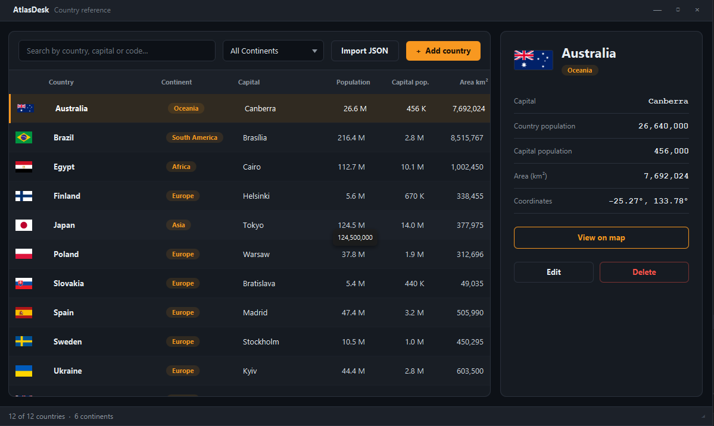

# AtlasDesk

A desktop country reference built with JavaFX. Search and filter countries, see details at a glance, locate any country on a world map, and grow the database with your own entries or a JSON import.



## Features

- **Instant search** by country, capital or ISO code, plus a **continent filter**
- **Sortable table** with flags, continent chips and compact population numbers (hover for the full value)
- **Detail card** with capital, populations, area and coordinates
- **World map dialog** with a pulsing marker at the country's location
- **Add, edit and delete** countries (double-click a row to edit, `Delete` key to remove)
- **Any continent**: pick an existing one or type a new one; the filter updates automatically
- **JSON import** for adding many countries at once, with duplicate protection and a summary report
- **Local SQLite database**, no server and no setup
- Dark theme with orange accents, custom window controls, resizable

## Requirements

- Java 21+ (JavaFX is bundled in the jar)
- Internet access for flag images (offline, the ISO code is shown instead)

## Run

Download the jar for your platform from the [Releases](https://github.com/vbforge/java-desktop-labs/releases) page:

| Platform | Jar |
|---|---|
| Windows | `atlasdesk-1.0.0-win.jar` |
| macOS (Intel) | `atlasdesk-1.0.0-mac.jar` |
| macOS (Apple Silicon) | `atlasdesk-1.0.0-mac-aarch64.jar` |
| Linux | `atlasdesk-1.0.0-linux.jar` |

```bash
java -jar atlasdesk-1.0.0-win.jar
```

## Build from source

```bash
mvn javafx:run        # run in development
mvn clean package     # builds target/atlasdesk-1.0.0-<platform>.jar
```

## Data

The database lives in `~/.atlasdesk/atlas.db` and is created on first start from the bundled `seed-countries.json`. The seed is only applied to an empty database, so your edits and deletions are never overwritten. To start over, delete the file.

### Importing countries

Use **Import JSON** in the toolbar. The file is a JSON array (or an object with a `countries` array):

```json
[
  {
    "code": "PL",
    "name": "Poland",
    "continent": "Europe",
    "capital": "Warsaw",
    "countryPopulation": 37750000,
    "capitalPopulation": 1860000,
    "area": 312696,
    "latitude": 51.9194,
    "longitude": 19.1451
  }
]
```

How entries are handled:

| Case | Result |
|---|---|
| New country | Added |
| ISO code already in the database | Skipped, existing data is kept |
| Same code repeated in the file | First one wins, the rest are skipped |
| Invalid entry (bad code, missing field, coordinates out of range) | Skipped and reported |

Codes are normalised to uppercase and continent names are matched case-insensitively. Duplicates are prevented by a `UNIQUE` constraint on the ISO code in the database, and every entry is validated before it is inserted. The whole import runs in one transaction.

## Project structure

```
src/main/java/com/vbforge/atlasdesk/
├── Launcher.java            entry point for the fat jar
├── AtlasDeskApp.java        UI: layout, table, card, map dialog
├── CountryFormDialog.java   add / edit form with validation
├── CountryImporter.java     JSON import and validation
├── CountryDao.java          SQLite access
├── Db.java                  connection, schema, seeding
├── FlagService.java         cached flag loading
├── Fx.java                  UI helpers (dialogs, formatting, dragging)
└── Country.java             record
src/main/resources/
├── atlasdesk.css
├── seed-countries.json
├── add.json                 example (to add data) 
└── world-map.png
```

## Tech stack

JavaFX 21 · SQLite (sqlite-jdbc) · Jackson · Maven · Java 21

Flag images are provided by [flagcdn.com](https://flagcdn.com).