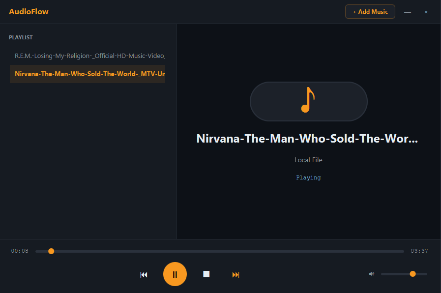

# AudioFlow

> Minimal dark-themed local audio player.




A sleek, distraction-free desktop player for your local music. Load your
favorite tracks, manage your playlist, and enjoy a responsive, fully
customizable interface that matches the rest of the portfolio.

## Features

- **Local Audio Playback**: Supports `.mp3` and `.wav` files.
- **Custom Dark UI**: Matches the FocusSprint theme with a custom title bar, removing the standard OS window frame.
- **Playlist Management**: Add multiple tracks, double-click to play, and auto-play the next track when one finishes.
- **Full Controls**: Play, Pause, Stop, Next, Previous, and a scrubbable seek bar.
- **Volume Control**: Adjust volume smoothly with a custom slider.

## Tech

Java 21 · JavaFX 21 (Media API) · Maven

## Run it

**From a release** (needs Java 21+ only):

```bash
java -jar audioflow-1.0.0-win.jar
```

Grab the jar matching your OS from the [Releases page](https://github.com/vbforge/java-desktop-labs/releases/tag/audioflow-v1.0.0).

**From source** (needs JDK 21 and Maven):

```bash
cd apps/audioflow
mvn clean javafx:run
```

## What I learned

- **JavaFX's `StageStyle.UNDECORATED` removes native window chrome.** To
  build a truly custom dark theme, we have to remove the OS title bar and
  draw our own. The trick is adding mouse listeners to the custom title
  bar to manually handle window dragging (`setOnMousePressed` and
  `setOnMouseDragged`).

- **Styling JavaFX `ScrollPane` and `ListView` is notoriously difficult.**
  The native scrollbars come with a white background and arrow buttons. We
  use CSS to make the track transparent, style the thumb to match the dark
  theme, and set the arrow buttons to `-fx-shape: " "` to make them
  invisible.

- **`MediaPlayer` state transitions are asynchronous.** When you call
  `mediaPlayer.play()`, the audio doesn't start immediately. We use
  `setOnReady()` to update the UI only when the media is fully loaded,
  preventing the UI from showing `00:00` if the file takes a moment to
  buffer.

- **Handling seek bar feedback loops.** Listening to
  `mediaPlayer.currentTimeProperty()` is perfect for updating the seek bar
  as the song plays. However, when the user drags the slider, it triggers
  value changes that would fight the media player. We use an `isSeeking`
  boolean to ignore player updates while the user is interacting with the
  slider.

## License

MIT — see [LICENSE](../../LICENSE).