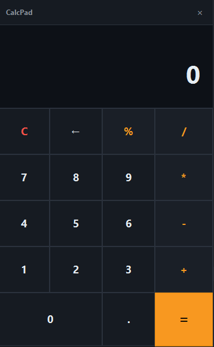

# CalcPad

> Keyboard-friendly calculator with precise decimal arithmetic.




A calculator that actually calculates. Supports decimals, keyboard input,
backspace, and division by zero protection — all while doing exact arithmetic
instead of floating-point approximations.

## Features

- Full keyboard support (numbers, operators, Enter for `=`, Backspace, Esc to clear)
- Exact `BigDecimal` math (no `0.1 + 0.2 = 0.30000000000000004` weirdness)
- Prevents division by zero without crashing
- Shows the current expression above the result
- Clean dark UI with clear operator precedence

## Run it

**From a release** (needs Java 21+):

```bash
java -jar calcpad-1.0.0-win.jar
```

**From source:**

```bash
cd apps/calcpad
mvn clean javafx:run
```

## What I learned

- **`double` is the wrong type for money or exact decimals.** The original
  version used `int`, which meant `5 / 2 = 2`. Switching to `double` fixes
  that but introduces precision errors. `BigDecimal` with `MathContext.DECIMAL64`
  is the standard fix for calculators.

- **Crashing on division by zero is unacceptable.** The original app threw
  an `ArithmeticException` and crashed. The engine now catches it, sets an
  error state, and forces the user to press `C` before continuing.

- **Separating logic from UI makes testing possible.** By moving math into
  `CalcEngine`, we can eventually write JUnit tests without needing a
  display. The UI layer becomes just a dumb button-mapper.

- **`GridPane` is perfect for calculators.** With `Hgrow/Vgrow` set to
  `ALWAYS`, the buttons resize naturally with the window. Spanning the `0`
  across two columns and the `=` across two rows gives a modern layout.

- **Keyboard support is mandatory.** Nobody wants to click 5 times to type
  a number. Wiring `scene.setOnKeyPressed` to the same engine methods as the
  buttons costs 15 lines of code and makes the app 10x more usable.

## License

MIT — see [LICENSE](../../LICENSE).