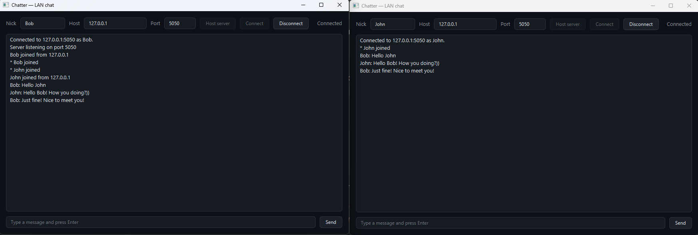
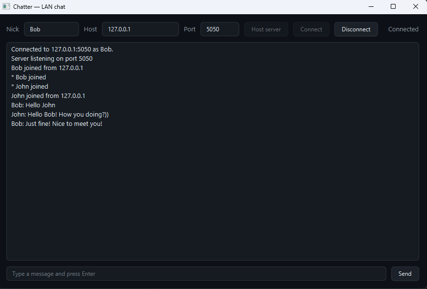
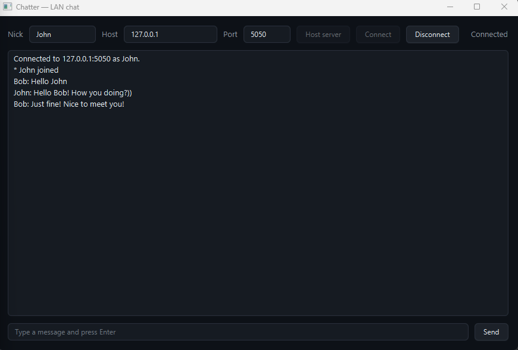

# Chatter

> Minimal LAN chat over TCP, in one jar.






One window that can act as a server, a client, or both. Click **Host server**
to start a server and connect to it locally, or **Connect** to join a server
someone else is running.

## Features

- TCP server with one reader thread per connected client
- Client and server in the same window — no separate processes to manage
- Newline-delimited UTF-8 protocol, debuggable with `telnet`
- Clean connect / disconnect handling
- Thread-safe broadcast to all connected clients

## Tech

Java 21 · JavaFX 21 · Maven · zero runtime dependencies beyond JavaFX

## Run it

**From a release** (needs Java 21+ only):

```bash
java -jar chatter-1.0.0-win.jar
```

Grab the jar matching your OS from the [Releases page](https://github.com/vbforge/java-desktop-labs/releases/tag/chatter-v1.0.0).

Run it twice for a two-person chat: once on the machine hosting, once on
the machine joining. Same jar, no configuration.

**From source:**

```bash
cd apps/chatter
mvn clean javafx:run
```

## Try it with telnet

#### Enable Telnet (recommended if needed Telnet)

1. Press Start.
2. Type `PowerShell`.
3. Right-click Windows PowerShell and select Run as administrator.
4. Run:
   ```
   dism /online /Enable-Feature /FeatureName:TelnetClient
   ```
5. After it completes, return to your regular PowerShell and run:
   ```
   telnet localhost 5050
   ```

The protocol is one line per message. You can talk to the server with any
TCP client:

```bash
telnet localhost 5050
HELLO terminal-user
hello from the terminal
```

## Protocol

Client → server, newline-delimited UTF-8:

```
HELLO <nickname>     the first line after connecting
<anything else>      a chat message
```

Server → client:

```
* <nickname> joined
* <nickname> left
<nickname>: <text>
```

That's the whole protocol.

## What I learned

- **Sockets are blocking, so threads are unavoidable.** A server that
  accepts connections and reads from them must have one thread per
  connection. There is no async socket API in the JDK that avoids this.

- **`Platform.runLater` vs `Task`.** PixelForge used `Task`, which is
  a wrapper around "run this function off the FX thread and deliver the
  result back to it." Chatter has N reader threads, one per client, and
  no single result to deliver — just text to append. `Platform.runLater`
  is the raw primitive that works from anywhere; `Task` is the polite
  wrapper for a specific shape of work.

- **`CopyOnWriteArrayList` is the right list for a broadcast set.**
  Reads (broadcasts) are frequent; writes (connect/disconnect) are rare.
  A plain `ArrayList` would throw `ConcurrentModificationException` the
  moment a second client connected mid-broadcast.

- **`PrintWriter` is not thread-safe.** Each client handler wraps its
  write in a per-handler `synchronized` block. Without it, two
  simultaneous broadcasts interleave and corrupt each other's messages.

- **Distinguish "I hung up" from "they hung up."** A `volatile boolean
  running` flag set *before* closing the socket lets the reader thread
  know whether the resulting IOException was expected or a genuine
  disconnect worth reporting.

- **Keep the network layer FX-free.** `ChatServer` and `ChatClient`
  take a `Consumer<String>` callback and have no JavaFX dependency. This
  makes them testable without a toolkit, and keeps the "which thread am
  I on?" reasoning contained to one class (`ChatterApp`).

## License

MIT — see [LICENSE](../../LICENSE).