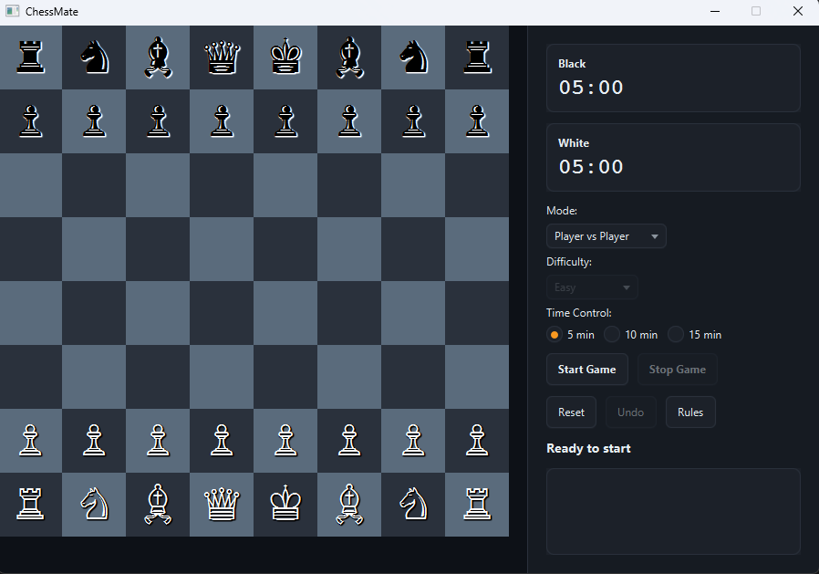

# ChessMate

> Full-featured Chess with a Minimax AI, player-vs-player clocks, and material scoring.




A complete desktop chess application. Play against a friend locally with 
chess clocks, or challenge the computer. The app handles all chess rules 
flawlessly (castling, en passant, promotion, stalemate) while providing a 
clean, responsive interface with move history and undo.

## Features

- **Player vs Player** and **Player vs AI** modes
- **AI Difficulty**: Easy (random selection) and Advanced (Minimax with Alpha-Beta pruning)
- **Chess Clocks**: 5, 10, or 15-minute timers for PvP mode (pauses when viewing rules)
- **Material Scoring**: If a game is stopped or time runs out, the winner is decided by captured material points (Pawn=1, Knight=3, Bishop=3, Rook=5, Queen=9)
- **Game State Management**: Explicit Start, Stop, and Reset controls to prevent accidental moves
- **Undo**: Reverts two moves in PvAI (yours and the AI's) or one move in PvP
- **Move History**: Algebraic notation displayed in real-time

## Tech

Java 21 · JavaFX 21 · `chesslib` (Rule Engine) · Maven

## The Rule Engine

Writing a fully correct chess engine from scratch is notoriously difficult. 
Missing a single edge case in en passant or castling can break the game. 
Instead of reinventing the wheel, ChessMate uses **`chesslib`**, a 
battle-tested Java library that handles the board state, legal move 
generation, and check/checkmate detection.

This separation of concerns is deliberate: `chesslib` acts as the pure 
domain model, while the JavaFX code acts purely as a view and input 
controller. The AI is a separate layer that queries the board state from 
the engine, simulates moves, and evaluates the outcome.

## Run it

**From a release** (needs Java 21+ only):

```bash
java -jar chessmate-1.0.0-win.jar
```

Grab the jar matching your OS from the [Releases page](https://github.com/vbforge/java-desktop-labs/releases/tag/chessmate-v1.0.0).

**From source** (needs JDK 21 and Maven):

```bash
cd apps/chessmate
mvn clean javafx:run
```

## What I learned

- **`chesslib` is a game-changer for UI development.** By delegating all
  move validation to a well-tested library, the UI code simply asks: "What
  are the legal moves from this square?" and highlights them. It eliminates
  an entire class of bugs related to illegal moves.

- **Minimax with Alpha-Beta pruning is elegant but expensive.** The AI
  looks 3 moves ahead. To prevent it from freezing the UI, the AI
  calculation is wrapped in a `javafx.concurrent.Task` and run on a background
  thread. When it finishes, the UI updates via `onSucceeded`.

- **Game state must be a strict state machine.** The app has states for
  *Ready*, *Playing*, *AI Thinking*, and *Game Over*. If you don't track
  these explicitly, users can click pieces while the AI is thinking, or
  move pieces after the game has ended. The `Start`, `Stop`, and `Reset`
  buttons control the transitions between these states.

- **Time controls need a fallback resolution.** In a real chess game, time
  running out results in a loss. But in this app, a user might manually
  stop a game early. To make the outcome meaningful, we calculate the
  "material points" of all remaining pieces on the board. This provides a
  satisfying, immediate conclusion to a stopped match.

- **Undo mechanics differ by mode.** In PvP, a single `board.undoMove()`
  reverts the last action. In PvAI, undoing once would leave the AI to
  immediately move again. By calling `undoMove()` twice, the player is
  taken back to the exact state before they made their move.

## License

MIT — see [LICENSE](../../LICENSE).
