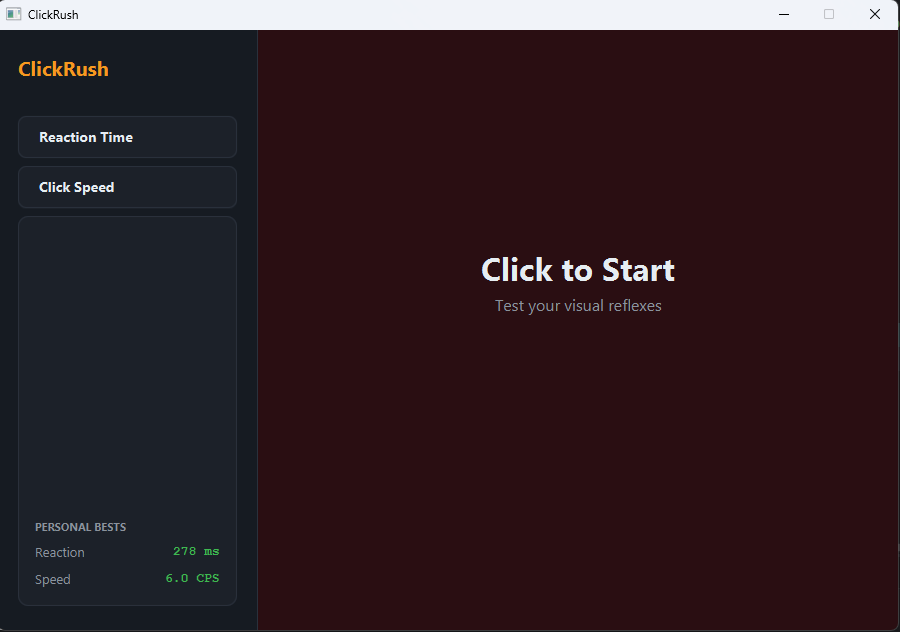

# ClickRush

> Reflex and clicking speed trainer with local high scores.




A desktop app for testing and training your mouse speed. It features two modes:
a **Reaction Time** test that measures your visual reflexes to the millisecond,
and a **Click Speed** test that measures your raw Clicks Per Second (CPS).

Your Personal Bests are saved locally to SQLite, so you can compete against yourself
across sessions.

## Features

- **Reaction Mode**: Wait for the screen to turn green, then click as fast as possible.
- **Speed Mode**: Click as many times as you can in 5, 10, or 30 seconds.
- **Live CPS Meter**: See your clicks per second update in real-time while clicking.
- **Persistent PBs**: High scores are saved to `~/.clickrush/clickrush.db`.
- **Clean, distraction-free UI**.

## Tech

Java 21 · JavaFX 21 · SQLite (via `sqlite-jdbc`) · Maven

## Run it

**From a release** (needs Java 21+ only):

```bash
java -jar clickrush-1.0.0-win.jar
```

**From source** (needs JDK 21 and Maven):

```bash
cd apps/clickrush
mvn clean javafx:run
```

## What I learned

- **High-resolution timing requires `System.nanoTime()`.** For the Reaction game,
  `System.currentTimeMillis()` isn't precise enough; it can jump backwards or forwards
  due to OS clock adjustments. `nanoTime()` is guaranteed to be monotonic and precise
  to the microsecond, which is essential for measuring human reflexes.

- **`PauseTransition` is perfect for "random delay" logic.** Instead of blocking the
  thread with `Thread.sleep()`, we use a `PauseTransition` to trigger the "GO" state.
  This keeps the UI perfectly responsive.

- **State machines prevent UI bugs.** The `ReactionGame` uses an explicit `State` enum
  (`IDLE`, `WAITING`, `READY`). If a user clicks while `WAITING`, it penalizes them.
  If they click while `READY`, it records the score. This makes the interaction logic
  bulletproof.

- **`AnimationTimer` handles the countdown UI smoothly.** For the Speed game, a
  `Timeline` would work, but `AnimationTimer` gives us the exact delta time, allowing
  the clock to display tenths of a second smoothly at 60 FPS without drift.

- **SQLite allows instant "game feel" upgrades.** Persisting the high score makes the app
  feel like a real game. The `ON CONFLICT DO UPDATE` syntax in SQLite is a lifesaver
  here, as it acts as a seamless "insert if new, update if exists" command.

## License

MIT — see [LICENSE](../../LICENSE).