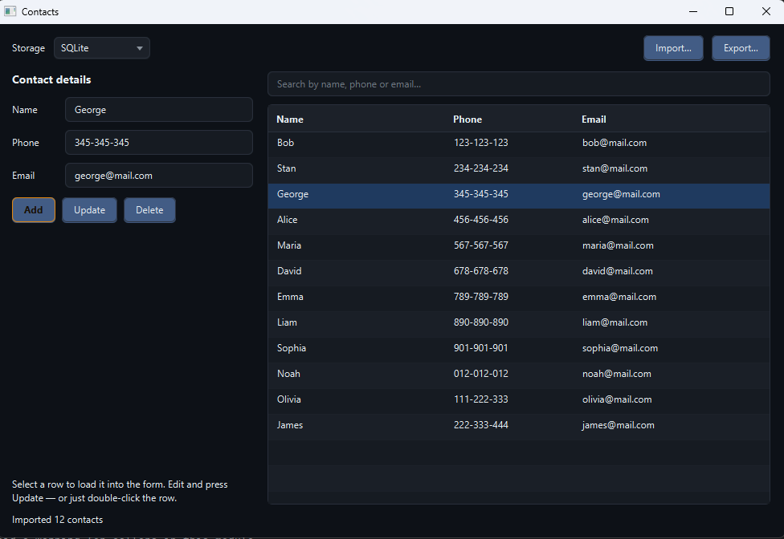

# Contacts

> Address book with switchable storage — SQLite, CSV or JSON — and cross-format import/export.




Store contacts locally in whichever format you prefer. Write once, read
anywhere — a JSON export opens in a spreadsheet just as happily as a CSV
one, and every backend is a first-class citizen of the same interface.

## Features

- Three interchangeable storage backends: SQLite, CSV, JSON
- Switch backend at runtime; migrate existing contacts or start fresh
- Export to any format, regardless of the current backend
- Import from CSV / JSON / SQLite files, merge or replace
- Live search across name, phone and email
- FXML-driven UI with a shared dark stylesheet

## Tech

Java 21 · JavaFX 21 · FXML · SQLite (via `sqlite-jdbc`) · Gson · Maven

## The storage abstraction

```
                     ┌──────────────────────┐
                     │  ContactsController  │
                     └──────────┬───────────┘
                                │ holds
                     ┌──────────▼───────────┐
                     │ ContactRepository    │  ← interface
                     │  findAll()           │
                     │  saveAll(List)       │
                     └──────────┬───────────┘
                                │
       ┌────────────────────────┼────────────────────────┐
       │                        │                        │
 ┌─────▼─────┐           ┌──────▼──────┐          ┌──────▼──────┐
 │  SQLite   │           │    CSV      │          │    JSON     │
 └───────────┘           └─────────────┘          └─────────────┘
```

Two methods. That's the whole contract. It is deliberately **not**
`insert` / `update` / `delete` — a SQL `UPDATE` has no natural CSV
equivalent, so a per-record API would leak one backend's shape into the
others. Read-all / write-all is the smallest interface that all three
formats can implement honestly.

## Run it

**From a release** (needs Java 21+ only):

```bash
java -jar contacts-1.0.0-win.jar
```

Grab the jar matching your OS from the [Releases page](https://github.com/vbforge/java-desktop-labs/releases/tag/contacts-v1.0.0).

**From source** (needs JDK 21 and Maven):

```bash
cd apps/contacts
mvn clean javafx:run
```

## Where the data lives

```
Windows:  C:\Users\<you>\.contacts\
macOS:    /Users/<you>/.contacts/
Linux:    /home/<you>/.contacts/
```

The folder contains:

```
config.properties   which backend was last selected
contacts.db         SQLite database  (if you have ever used SQLite)
contacts.csv        CSV file         (if you have ever used CSV)
contacts.json       JSON file        (if you have ever used JSON)
```

- `tmp-data` folder at the root of the project contain 3 files: `contacts.{csv,db,json}` as example (easy import)

All three files can coexist — switching backends reads and writes only
the selected one. Delete the folder to reset everything.

## What I learned

- **"Read-all / write-all" beats a fine-grained CRUD interface when
  backends disagree on what CRUD means.** SQL has `UPDATE`, CSV has
  "rewrite the file", JSON has "serialise the whole list." The smallest
  contract all three can honour is two methods, not five. Trying to
  force a per-record API on top of CSV produces code that pretends to
  be efficient and is not.

- **A record makes the original app's worst bug impossible.** The
  starting version had commented-out getters on `MyContact`, so the UI
  could never read a selected contact back into the form — "Edit"
  silently replaced the row instead of editing it. A record's
  accessors are generated and cannot be commented out. The bug is
  structural, not accidental, in the old design.

- **`ServicesResourceTransformer` is non-optional for SQLite in a fat
  jar.** JDBC drivers register through `META-INF/services/java.sql.Driver`.
  Without this transformer, shade overwrites the file with whichever
  driver registers last and the JVM never sees your SQLite driver.
  Symptom: `No suitable driver found for jdbc:sqlite:…`, only in the
  shaded jar, never in `mvn javafx:run`.

- **CSV needs quoting rules, or it corrupts on the first comma.**
  A name like "Smith, John" splits into two fields under a naive
  `split(",")`. RFC 4180 says wrap the field in double quotes and double
  any embedded quotes. Ten lines of code, and now the file round-trips
  through Excel without damage.

- **Gson supports records, but a small DTO is safer.** The record's
  component order is an implementation detail; the JSON key names are a
  data format that real files depend on. A DTO decouples the two, so
  renaming a record component never silently breaks existing files.

- **Absolute positioning in FXML does not survive contact with real
  fonts.** The starting version used Scene Builder's default
  `layoutX` / `layoutY` on every component. It looked fine on the
  machine that generated it, and only on that machine. `BorderPane`
  plus `GridPane` costs five more lines and works everywhere.

- **Switching backends is a migration, not a settings toggle.** Real
  apps that let you pick a storage profile ask "move your data or start
  fresh?" — every time. We made that explicit with a `ChoiceDialog`
  rather than silently discarding data.

## License

MIT — see [LICENSE](../../LICENSE).