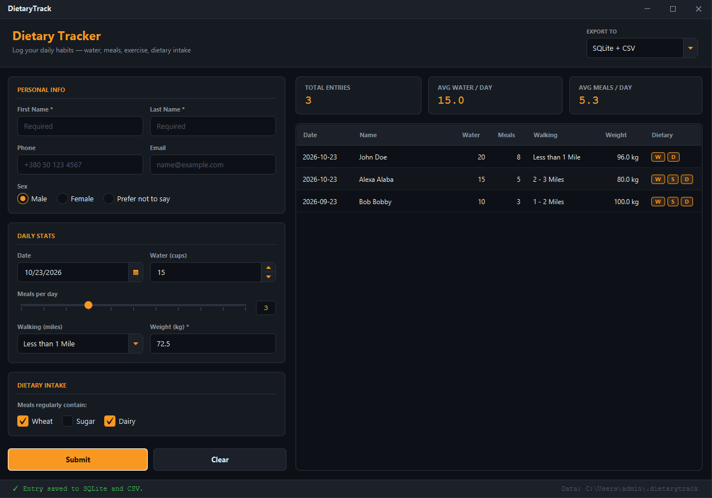

# DietaryTrack

> Daily dietary and habit tracker with local SQLite storage, CSV export, and real-time validation.




A clean, dark-themed desktop tool for logging your daily habits. Track water intake, meals, exercise, and dietary restrictions. Data is securely stored in a local SQLite database for in-app history, and can be simultaneously exported to a CSV file formatted for Excel.

## Features

- **Dual Persistence**: Save entries to SQLite (for the in-app history table) and/or a CSV file.
- **Real-time Validation**: Required fields and numeric inputs are validated as you type, with clear visual feedback.
- **Custom Window Frame**: Fully undecorated window with custom minimize/maximize/close buttons, edge-resizing, and drag-to-move.
- **Excel-Ready CSV Export**: Handles RFC 4180 quoting, UTF-8 BOM for correct character rendering in Excel, and neutralizes formula injection attacks.
- **Dynamic UI**: The history table automatically resizes to fit the data, and the form scrolls independently of the pinned Submit/Clear buttons.

## Project layout

| Class | Role |
|---|---|
| `Launcher` | Entry point for the shaded jar |
| `DietaryTrackApp` | Wires window, header, form, history and storage together |
| `WindowSupport`, `TitleBar` | Borderless window: drag, resize, minimize / maximize / close |
| `EntryFormPanel` | Scrollable form with validation; Submit / Clear are pinned below it |
| `HistoryPanel`, `StatusBar` | Stats cards, table, status messages |
| `Validators` | Pure, unit-tested validation rules |
| `DietaryDao`, `CsvExporter`, `ExportMode`, `Stats`, `AppPaths` | Storage and model |
| `dietarytrack.css` | The single dark/orange theme |

## Tech

Java 21 · JavaFX 21 · SQLite (via `sqlite-jdbc`) · JUnit 5 · Maven

## Where the data lives

```
Windows:  C:\Users\<you>\.dietarytrack\
macOS:    /Users/<you>/.dietarytrack/
Linux:    /home/<you>/.dietarytrack/
```

The folder contains:
- `dietary.db` (SQLite database)
- `dietary.csv` (CSV export)

## Run it

**From a release** (needs Java 21+ only):

```bash
java -jar dietarytrack-1.0.0-win.jar
```

**From source** (needs JDK 21 and Maven):

```bash
cd apps/dietarytrack
mvn clean javafx:run
```

**Run the tests:**
```bash
mvn test
```

## What I learned

- **Excel CSV exports need a BOM.** If you write a standard UTF-8 CSV, Excel often misinterprets non-Latin characters (like Cyrillic names). Prepending the Byte Order Mark (`\uFEFF`) forces Excel to read the file as UTF-8.
- **CSV formula injection is a real security risk.** If a user types `=HYPERLINK("http://malicious.com")` into a name field, opening the CSV in Excel could execute it. The `CsvExporter` prevents this by prefixing risky strings with a single quote (`'`), neutralizing the formula.
- **Creating a borderless window requires manual math.** By using `StageStyle.UNDECORATED`, we lose the OS window frame. Implementing `WindowSupport` meant manually calculating the cursor bounds (edges/corners) and adjusting the `Stage` X/Y/Width/Height dynamically on mouse drag.
- **`TextFormatter` and property listeners make real-time validation possible.** Instead of waiting for a Submit button, `Validators` are bound to the property changes of the text fields, giving the user instant red/green feedback.
- **Decoupling pure logic makes testing trivial.** Because `Validators`, `Stats`, and `CsvExporter` have zero JavaFX dependencies, they run lightning-fast in JUnit without needing a UI thread.

## License

MIT — see [LICENSE](../../LICENSE).


