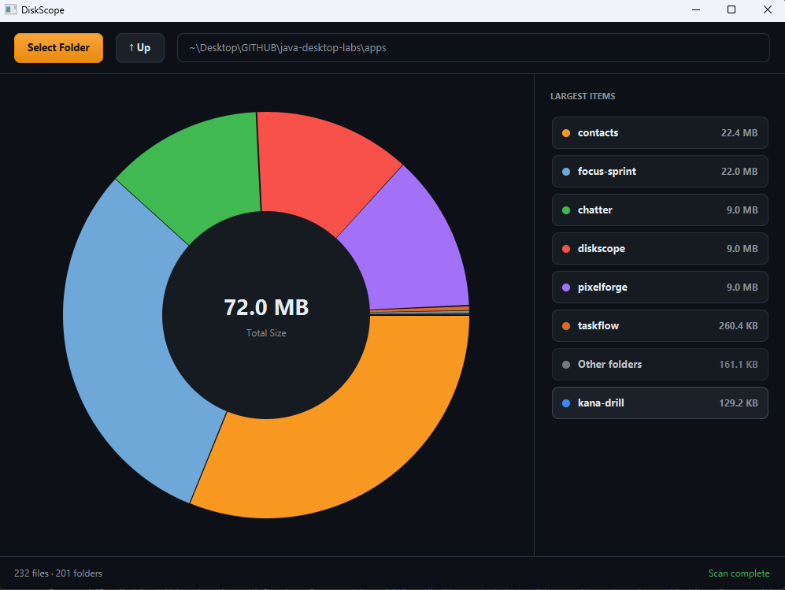

# DiskScope

> Interactive disk space analyzer with drill-down navigation and a live donut chart.




Pick a folder and DiskScope shows you exactly what is taking up space. The
chart displays the 7 largest items and groups the rest into an "Other" slice.
Click a folder in the chart or the side panel to drill down. Click **Up** to
go back. The status bar shows the total number of files and folders scanned.

## Features

- Multi-threaded background scanning (the UI never freezes)
- Top 7 folders + "Other" grouping prevents chart clutter
- Donut chart with total size in the center
- Drill-down navigation via chart clicks, side panel clicks, and an Up button
- Unreadable folders are skipped without crashing the app
- Human-readable file sizes (B / KB / MB / GB)
- Recursive file and folder counts in the status bar

## The Algorithm

The original version of this app walked the directory tree and updated the
size of *every* parent directory all the way up to the drive root. That meant
scanning `C:\Users\admin\Documents` also polluted the memory map with sizes
for `C:\Users\admin`, `C:\Users`, and `C:\`, slowing down the scan and breaking
navigation.

DiskScope calculates sizes differently. When you select a folder, it:

1. Lists the *immediate* children (files and subfolders).
2. For each subfolder, calculates its total recursive size (and counts its files/folders).
3. For each file, records its size directly.
4. Sorts the children by size and displays the top 7, grouping the rest.

This is O(N) for the selected folder, uses vastly less memory, and makes
clicking a pie slice instant because we don't have to scan the whole disk to
know what's inside it.

## Run it

**From a release** (needs Java 21+ only):

```bash
java -jar diskscope-1.0.0-win.jar
```

[Releases page](https://github.com/vbforge/java-desktop-labs/releases/tag/diskscope-v1.0.0)

**From source** (needs JDK 21 and Maven):

```bash
cd apps/diskscope
mvn clean javafx:run
```

## What I learned

- **`Task<T>` requires actual cancellation checks.** Calling
  `task.cancel()` sets a flag, but if the code inside `call()` is a tight
  loop over `Files.walk`, the thread never checks that flag. DiskScope solves
  this by checking `isCancelled()` inside the `FileVisitor` and returning
  `FileVisitResult.TERMINATE`, ensuring that switching folders mid-scan stops
  the IO immediately.

- **JavaFX `PieChart` layout is stubborn.** The `PieChart` calculates its
  drawing radius based on the smaller dimension of its container, but aligns
  itself to the center of the larger dimension. This pushes the chart off-center
  in wide layouts. The fix is to wrap the chart in a `StackPane` forced to be
  a perfect square (`setMaxSize(600, 600)`), which keeps the donut hole and
  text perfectly centered regardless of window resizing.

- **Coloring pie slices dynamically is tricky.** Setting `data.getNode()`
  immediately fails because JavaFX generates the chart nodes *after* the layout
  pass. You must wrap the styling in `Platform.runLater()`. Furthermore, the
  default Modena theme uses `-fx-background-color` for the slice, not just
  `-fx-pie-color`. To truly override the color, you must set both inline.

- **UI reconstruction is a mistake.** The original `Starter.java` called
  `stage.setScene(new Scene(...))` every time a folder was chosen. This causes
  the window to flicker, resize, and lose focus. The layout should be built
  once, and only the data (`PieChart.Data`, `ListView` items) should be mutated.

- **Custom legends are better than built-in ones.** JavaFX's built-in
  `PieChart` legend is rigid and hard to style. Disabling it
  (`pieChart.setLegendVisible(false)`) and creating a `VBox` of `HBox` rows
  lets us add hover states, click handlers, and exactly the colors we want.

## License

MIT — see [LICENSE](../../LICENSE).

