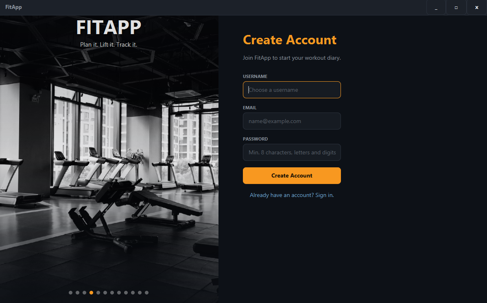

# FitApp

Local-first fitness and workout tracker. Java 21, JavaFX 21, SQLite, JUnit 5, Maven.
Data lives in `~/.fitapp/fitapp.db`; "Remember me" is stored in `~/.fitapp/config.properties` (username only).

## Requirements
- JDK 21+
- Maven 3.9+

## Run from source
    mvn javafx:run

## Run the tests
    mvn test

## Build the fat jar
    mvn clean package
    java -jar target/fitapp-1.0.0.jar

The JavaFX platform classifier (linux / win / mac / mac-aarch64) is chosen automatically by a Maven profile.
The jar contains natives for the OS it was built on only, so build it on each target OS
(or force one with `-Djavafx.platform=win`).

## Features
- Register / login (salted SHA-256), Remember me, offline "Forgot password" by email
- Sliding login/register card, custom undecorated window
- Account: live clock, last 5 logins, change password
- Workouts and exercises (sets and reps) with live search, edit and delete
- Workout manager: link exercises to a workout

## Release
    git tag fitapp-v1.0.0
Upload `target/fitapp-1.0.0.jar` to a GitHub Release.
