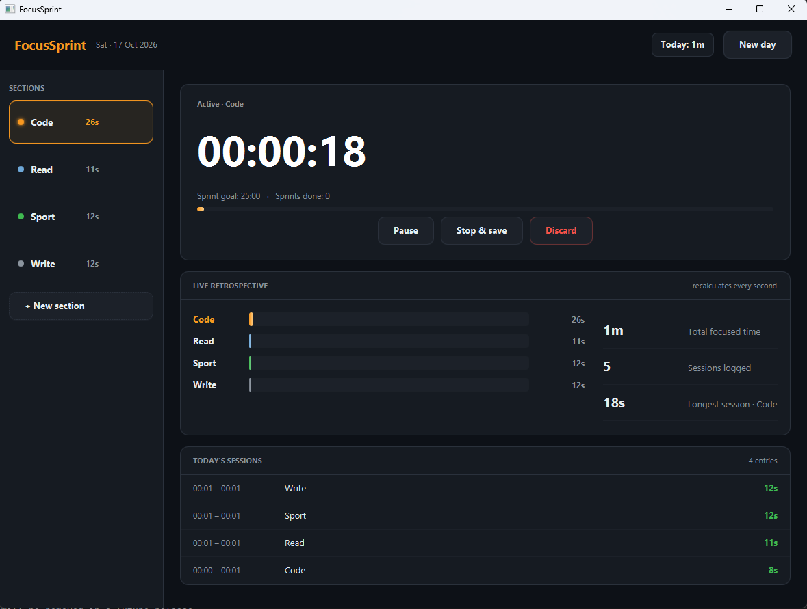

# FocusSprint

> Track your day by section — Code, Read, Sport, whatever — and watch the retrospective update live.




Click a section to start a timer. The bar for that section grows in real
time, the totals tick up, the sessions log fills in as you go. No
end-of-day report to wait for — you see exactly where your hours are
going while you can still do something about it.

## Features

- Create, rename, delete sections on the fly
- One-tap start; switching sections logs the previous session automatically
- Pause and resume without splitting the session
- Discard a session you didn't mean to start
- Live retrospective: per-section bars, totals, session count, longest session
- Explicit **New day** button — you decide when the day ends, not the clock
- SQLite storage in `~/.focussprint/`, fully queryable

## Tech

Java 21 · JavaFX 21 · SQLite (via `sqlite-jdbc`) · Maven

## Run it

**From a release** (needs Java 21+ only):

```bash
java -jar focus-sprint-1.0.0-win.jar
```

Grab the jar matching your OS from the [Releases page](https://github.com/vbforge/java-desktop-labs/releases/tag/focus-sprint-v1.0.0).

**From source** (needs JDK 21 and Maven):

```bash
cd apps/focus-sprint
mvn clean javafx:run
```

## Where the data lives

```
Windows:  C:\Users\<you>\.focussprint\
macOS:    /Users/<you>/.focussprint/
Linux:    /home/<you>/.focussprint/
```

Two files:

```
config.properties   day-start boundary timestamp
focussprint.db      sections and sessions
```

Delete `focussprint.db` to lose all history. Delete `config.properties`
to reset the day boundary.

## Storage model

Two tables. Sessions are stored row-per-session; the retrospective is a
query, never a stored value.

```sql
CREATE TABLE sections (
    id         INTEGER PRIMARY KEY AUTOINCREMENT,
    name       TEXT NOT NULL,
    tone       TEXT NOT NULL DEFAULT 'orange',
    sort_order INTEGER NOT NULL DEFAULT 0
);

CREATE TABLE sessions (
    id         INTEGER PRIMARY KEY AUTOINCREMENT,
    section_id INTEGER NOT NULL REFERENCES sections(id) ON DELETE CASCADE,
    started_at INTEGER NOT NULL,   -- epoch millis
    ended_at   INTEGER NOT NULL,
    seconds    INTEGER NOT NULL
);
```

### Why sessions, not daily totals

The obvious alternative is one row per `(date, section)` with cumulative
seconds. It has one advantage — fewer rows — and three real problems:

1. **"Fix a bad entry" becomes impossible.** If a timer runs unattended
   for four hours, you can delete that one row with the session model.
   With daily totals, you'd have to reset the entire day's worth of that
   section.

2. **The session log needs sessions anyway.** Today's-sessions panel is a
   per-session view. Daily totals would need a second table, and then the
   two could drift.

3. **The "duplicate day" concern is a symptom of the wrong design.** If
   you save the retrospective, you worry about saving it twice. If you
   never store the retrospective — because it's a `SUM` — the concern
   doesn't exist.

### Day boundary

"Today" is not a calendar day. It's everything since the **last
`New day` click**, or since midnight if you've never clicked it. The
timestamp lives in `config.properties`. A session that runs past
midnight belongs to the day it *started*, which matches how people
actually think about a work session that ran late.

## What I learned

- **The retrospective should be a query, not a row.** Once the data model
  is `sessions`, the retrospective is `SELECT section_id, SUM(seconds)
  FROM sessions WHERE started_at >= ? GROUP BY section_id`, and every UI
  concern — does today's data overwrite yesterday's, what if I switch
  sections, what if I pause — resolves on its own. The design pressure to
  store a "day total" is a signal that the session row is missing a field,
  not that a second table is needed.

- **`AnimationTimer` at 60fps is not the same as updating the UI at
  60fps.** The timer fires every frame, but a ticking clock only changes
  once a second, and layout passes are not free. Guarding the update
  behind a "did the visible second change?" check keeps the CPU near
  idle between ticks without any scheduling complexity.

- **A pause is a state, not a session split.** The naive approach — end
  the current session, start a new one on resume — would produce three
  rows for one cup of coffee. Tracking `activeAccumulated` plus
  `resumedAt` keeps it as one session with a `paused` flag, and the
  database sees a single clean row on stop.

- **`ON DELETE CASCADE` matches what "Delete section" means.** Without
  it, deleting a section leaves orphan rows pointing at a nonexistent
  `section_id` and the log renders "(deleted)" next to real durations. The
  cascade is one line in the schema and one confirm dialog in the UI, and
  the two together mean "delete" is honest.

- **Saving on section switch, not on a timer, is why the DB is quiet.**
  The natural instinct is a checkpoint every N seconds. But a session is
  only meaningfully "done" at three moments — switch, stop, close — and
  writing at those moments keeps the write path tiny and eliminates the
  whole class of "partial row from a crashed process."

- **Day boundary as a timestamp beats day boundary as a date.** A user
  working till 01:00 wants that session to count as "yesterday." A
  midnight rollover splits it. Storing the boundary as an `Instant` and
  asking "is my last boundary before today's midnight?" once at startup
  handles both the automatic rollover and the manual "New day" click
  with one field.

## License

MIT — see [LICENSE](../../LICENSE).