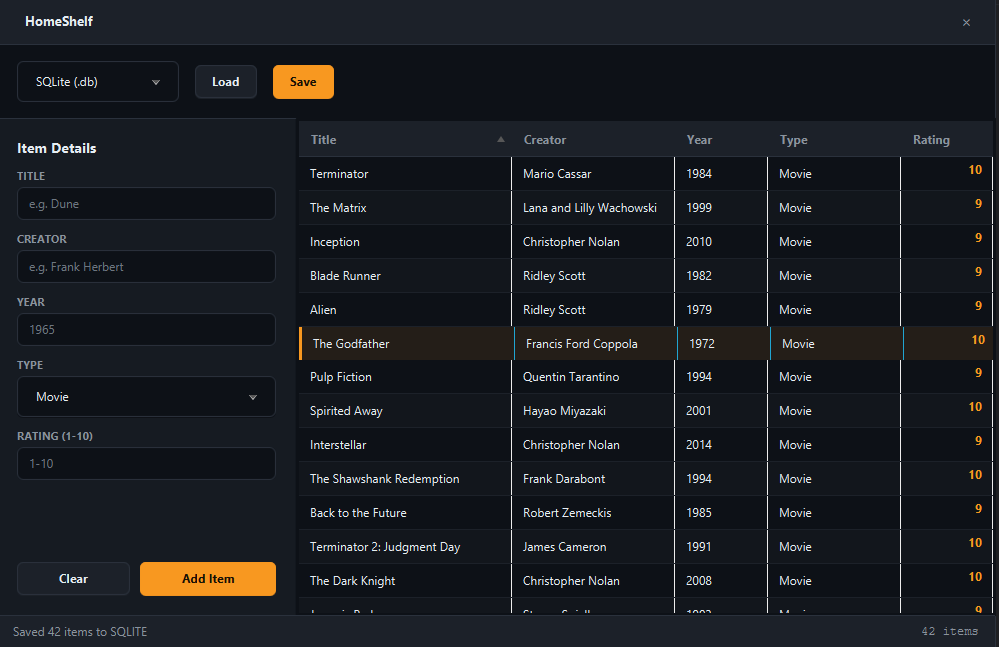

# HomeShelf

> Media library manager with switchable storage formats.




A clean, dark-themed desktop app for cataloging your books, movies, and
video games. HomeShelf allows you to add items with a title, creator, year,
and rating, and save your collection using one of six different data
serialization formats.

## Features

- **Media Tracking**: Add and remove items from your shelf.
- **Context Menu**: Right-click any row to quickly delete it.
- **Custom Dark Theme**: Built with the FocusSprint dark palette and custom
  title bar.
- **Switchable Storage**: Save and load your data as JSON, XML, SQLite,
  Binary, Java Object, or Properties.
- **Form Validation**: Rating is restricted to 1-10, Year must be numeric,
  and empty fields are rejected.
- **Persistent Storage**: Data is safely stored in `~/.homeshelf/`, keeping
  your application directory clean.

## Tech

Java 21 · JavaFX 21 · Jackson (JSON/XML) · SQLite JDBC · Maven

## Storage Architecture

The app uses the **Strategy Pattern** via the `DataProcess` interface:

```java
public interface DataProcess {
    void save(List<MediaItem> items) throws Exception;
    List<MediaItem> load() throws Exception;
}
```

This allows the app to swap out the underlying storage engine on the fly
without changing a single line of UI code. The dropdown in the toolbar
instantly switches between:
- **JSON**: Handled by Jackson `ObjectMapper`.
- **XML**: Handled by the Java DOM API.
- **SQLite**: Handled by `sqlite-jdbc` with batch inserts.
- **Binary / Object / Properties**: Implemented using standard Java IO.

## Run it

**From a release** (needs Java 21+ only):

```bash
java -jar homeshelf-1.0.0-win.jar
```

Grab the jar matching your OS from the [Releases page](https://github.com/vbforge/java-desktop-labs/releases/tag/homeshelf-v1.0.0).

**From source** (needs JDK 21 and Maven):

```bash
cd apps/homeshelf
mvn clean javafx:run
```

## What I learned

- **JavaFX `Spinner` controls are hard to style.** When you build a dark
  theme, the native up/down arrows on a `Spinner` stay white and clash
  horribly. To fix this, I replaced the `Spinner` with a standard `TextField`
  and used a `TextFormatter` to restrict input to numbers only. It looks
  much cleaner and matches the custom theme perfectly.

- **Scrollbars need explicit CSS.** By default, JavaFX adds a white,
  native-looking scrollbar to `TableView` and `ScrollPane`. I had to
  specifically target `.scroll-bar`, `.track`, and `.thumb` to make them
  transparent or dark grey, and hide the increment/decrement arrows.

- **SQLite `DELETE` + `INSERT` is faster with transactions.** When saving
  the whole list to SQLite, running `DELETE FROM` and then inserting
  hundreds of rows one by one is slow. Wrapping the operation in a
  transaction (`setAutoCommit(false)`) and using `executeBatch()` makes it
  nearly instantaneous.

- **Jackson handles Java Records out of the box.** Using a Java `record` for
  `MediaItem` made serializing and deserializing with Jackson incredibly
  simple. No need for getters, setters, or `@JsonProperty` annotations.

## License

MIT — see [LICENSE](../../LICENSE).