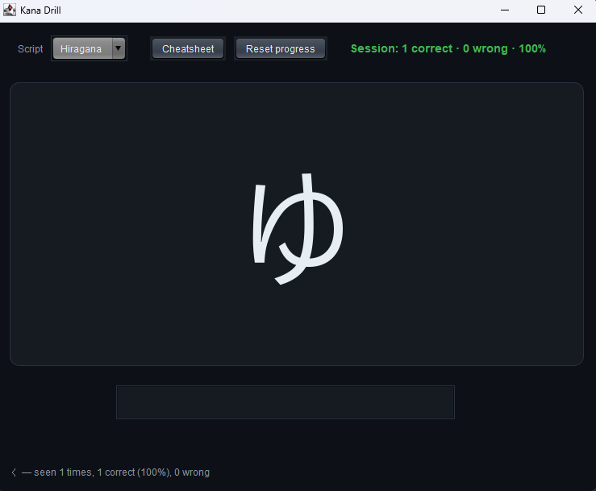

# Kana Drill

> Spaced-repetition flashcards for hiragana and katakana.




Type the romaji, press Enter, and see whether you remembered the kana.
Characters you get wrong come up more often; characters you know reliably
fade into the background. Progress is stored locally and persists between
sessions.

## Features

- All 46 basic hiragana and all 46 basic katakana
- Weighted-random spaced repetition — new and difficult characters get priority
- Accepts common alternate romanisations (`shi`/`si`, `tsu`/`tu`, `fu`/`hu`, `wo`/`o`)
- Green/red flash animation on answer
- Per-character stats persisted to `~/.kanadrill/stats.csv`
- Cheatsheet dialog showing the full grid
- Reset progress at any time

## Tech

Java 21 · Swing · Maven · zero runtime dependencies

Swing, not JavaFX. This one is deliberately in the other framework — the
rest of the repo is JavaFX and the goal here was to exercise the JDK's
built-in toolkit. The distribution story is also different: a Swing jar
is truly cross-platform, so there's only one artifact, not one per OS.

## Run it

**From a release** (needs Java 21+ only):

```bash
java -jar kana-drill-1.0.0.jar
```

**Download a release** — grab the jar from the
[Releases page](https://github.com/vbforge/java-desktop-labs/releases/tag/kana-drill-v1.0.0)

Same jar works on Windows, macOS and Linux.

**From source:**

```bash
cd apps/kana-drill
mvn clean compile exec:java
```

**Build a jar:**

```bash
mvn clean package
# → target/kana-drill-1.0.0.jar
```

## Where progress is stored

```
Windows:  C:\Users\<you>\.kanadrill\stats.csv
macOS:    /Users/<you>/.kanadrill/stats.csv
Linux:    /home/<you>/.kanadrill/stats.csv
```

A plain CSV file. Delete it — or hit **Reset progress** in the app — to
start fresh.

## Spaced repetition

Each character carries a weight based on how well you know it:

| Seen | Accuracy | Weight |
|---|---|---|
| never | —   | 2.0 |
| yes   | 0%  | 4.0 |
| yes   | 50% | 2.5 |
| yes   | 100%| 1.0 |

The next card is drawn by weighted random selection, so a character with
weight 4.0 shows up four times as often as one with weight 1.0. The
currently-displayed card is excluded from the draw so you never see the
same character twice in a row.

## What I learned

- **Swing has its own UI thread — the EDT.** `SwingUtilities.invokeLater`
  is the Swing equivalent of JavaFX's `Platform.runLater`. The rule is
  identical: only touch UI components from the UI thread. The difference
  is the name of the thread and the utility class.

- **`javax.swing.Timer` is not `java.util.Timer`.** The Swing timer fires
  its event on the EDT, so mutating UI state from inside its handler is
  safe. The JDK timer fires on its own thread and would corrupt Swing
  state silently. When in doubt, use the Swing one.

- **Swing styling is a UIManager affair.** There's no stylesheet. You
  either set `UIManager.put(...)` defaults *before* any component is
  constructed, or you paint components yourself. Doing the UIManager
  setup after a component exists gives you a half-styled window.

- **A custom `JPanel` is the escape hatch.** `paintComponent(Graphics)`
  with anti-aliasing hints gives you full control — rounded corners,
  soft flashes, animated overlays. This is why the flash card looks
  modern while the surrounding buttons look like Swing buttons.

- **A Swing jar is one jar for every platform.** JavaFX needs per-OS
  natives; Swing doesn't. The trade is that Swing's default look is
  dated, and modern styling has to be painted rather than declared.

- **Weighted random beats a scheduling queue for simple spaced
  repetition.** A full Leitner or SM-2 system needs a per-card schedule
  and a review calendar. Weighted selection gets 90% of the benefit for
  20% of the code — and it never gets stuck, because every card always
  has some chance of appearing.

## License

MIT — see [LICENSE](../../LICENSE).