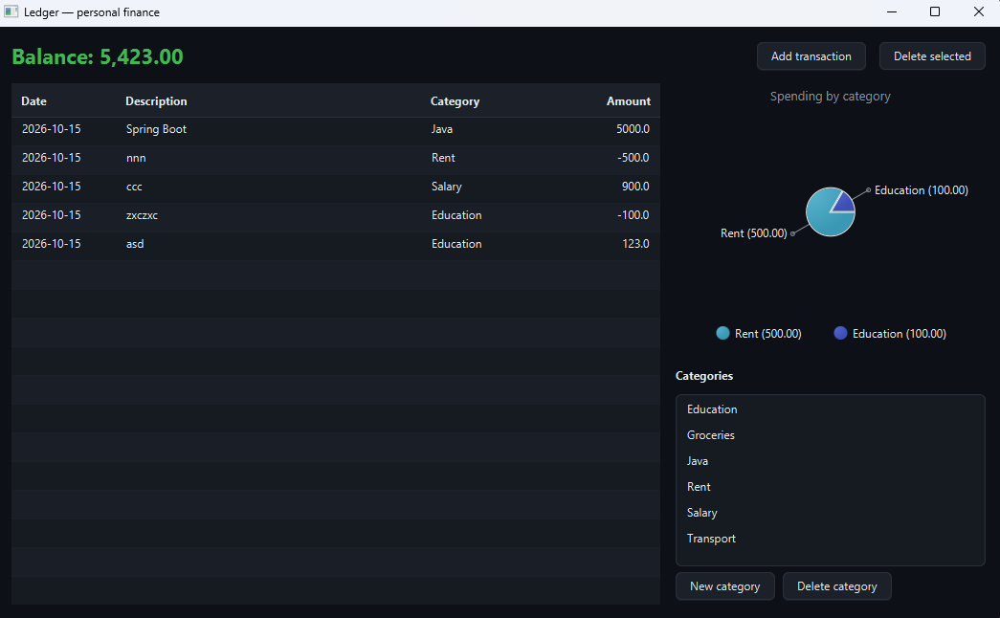

# Ledger

> Personal finance tracker with SQLite storage, CSV-ready table views and a live spending chart.




Track income and expenses in a local SQLite file. No account, no cloud,
no network — your data never leaves `~/.ledger/ledger.db`.

## Features

- Add and delete transactions with date, description, amount and category
- Live balance, colour-coded green for positive, red for negative
- Pie chart of spending grouped by category
- Editable descriptions directly in the table
- Manage categories; deleting one leaves its transactions intact (marked uncategorised)
- Schema auto-created on first launch, seeded with sensible defaults

## Tech

Java 21 · JavaFX 21 · SQLite (via `sqlite-jdbc`) · Maven

## Run it

**From a release** (needs Java 21+ only):

```bash
java -jar ledger-1.0.0-win.jar
```

Grab the jar matching your OS from the [Releases page](https://github.com/vbforge/java-desktop-labs/releases/tag/ledger-v1.0.0).

**From source** (needs JDK 21 and Maven):

```bash
cd apps/ledger
mvn clean javafx:run
```

## Where the data lives

```
Windows:  C:\Users\<you>\.ledger\ledger.db
macOS:    /Users/<you>/.ledger/ledger.db
Linux:    /home/<you>/.ledger/ledger.db
```

Delete that file to start fresh. It's a plain SQLite database — open it with
`sqlite3 ~/.ledger/ledger.db` to poke around.

## What I learned

- **JDBC is one API, many drivers.** `DriverManager.getConnection("jdbc:sqlite:...")`
  looks identical to a Postgres or MySQL call. The driver jar registers itself
  via `META-INF/services/java.sql.Driver`, which is why the shade plugin needs
  the `ServicesResourceTransformer` — without it the fat jar silently loses
  the registration and you get `No suitable driver found`.
- **SQLite needs `PRAGMA foreign_keys = ON`.** Referential integrity is off
  by default for backwards compatibility. Forgetting this makes
  `ON DELETE SET NULL` a no-op.
- **`ON DELETE SET NULL` beats `ON DELETE CASCADE` for financial records.**
  Deleting a category shouldn't erase the money that was spent under it.
- **`TableView` binds to properties, not getters.** Every displayed field
  needs a `Property` object; a record can't hold them, so a thin
  `TransactionRow` view model wraps the domain record.
- **`INSERT OR IGNORE` makes schema setup idempotent.** Running it on every
  launch is safe and removes the "did I already seed?" question.

## License

MIT — see [LICENSE](../../LICENSE).