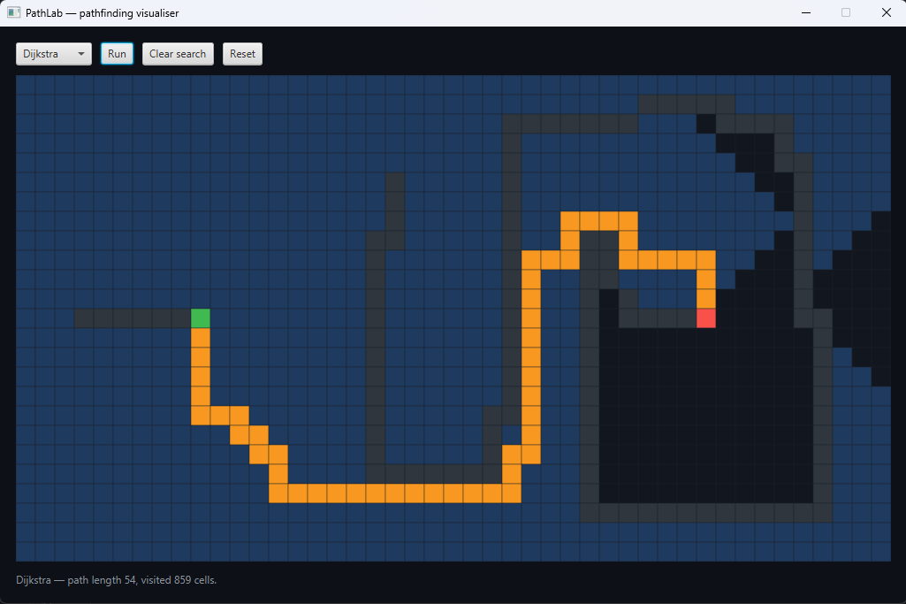
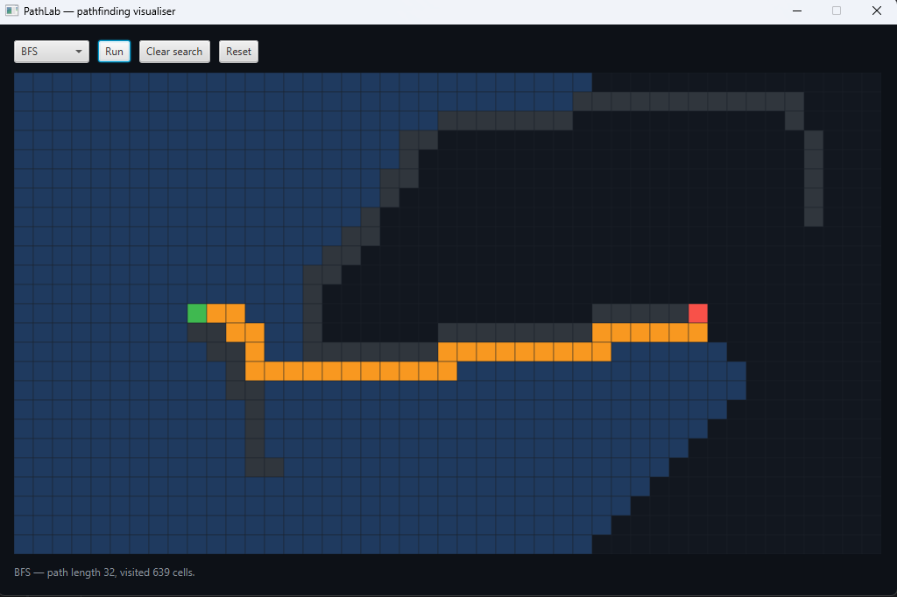
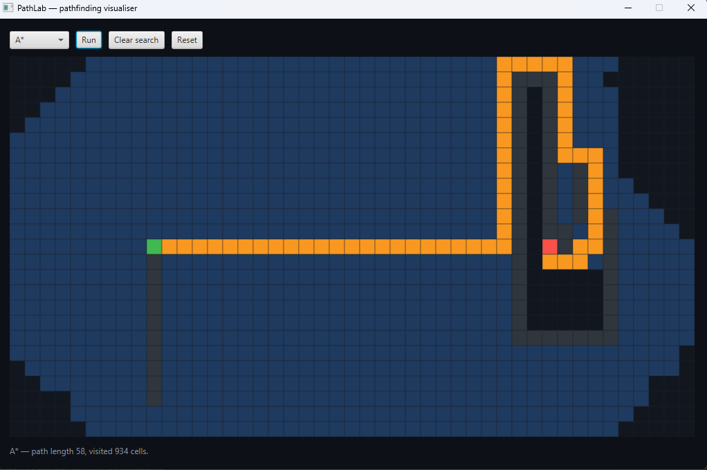

# PathLab

> Grid-based pathfinding visualizer — BFS, Dijkstra and A* on a 4-connected grid.




Draw walls with the mouse, pick an algorithm, and watch the search expand
one cell at a time before the shortest path is traced.

All three algorithms find an optimal path on this grid — they differ only
in *which order* they explore. A* reaches the target having touched far
fewer cells, which is the whole point of the heuristic.

## Features

- BFS, Dijkstra and A* on a uniform-cost grid
- Click-and-drag wall drawing; drag from a wall to erase
- Animated exploration and path tracing
- Adjustable speed — animation auto-scales to grid size
- No dependencies beyond JavaFX

## Tech

Java 21 · JavaFX 21 · Maven

## Run it

**From a release** (needs Java 21+ only — no Maven, no JavaFX SDK):

```bash
java -jar pathlab-1.0.0-win.jar
```

The jar is platform-specific because it bundles JavaFX natives. Grab the
one matching your OS from the [Releases page](https://github.com/vbforge/java-desktop-labs/releases).

**From source** (needs JDK 21 and Maven):

```bash
cd apps/pathlab
mvn clean javafx:run
```

**Build a jar yourself:**

```bash
mvn clean package
# → target/pathlab-1.0.0-<platform>.jar
```

## Screenshots

| BFS                         | A*                           |
|-----------------------------|------------------------------|
|  |  |

## What I learned

- The JVM refuses to launch a fat jar whose main class extends
  `javafx.application.Application` — it demands JavaFX on the module path.
  A one-line `Launcher` class that doesn't extend `Application` sidesteps it.
- JavaFX was unbundled from the JDK at Java 11, so a plain `mvn package`
  produces a jar that dies with *"JavaFX runtime components are missing"*.
  Bundling the platform-classified JavaFX artifacts fixes it.
- Wall-drawing needs the erase/draw mode locked in on mouse-press, not
  recomputed per-drag, or a drag over an existing wall flickers.

## License

MIT — see [LICENSE](../../LICENSE).