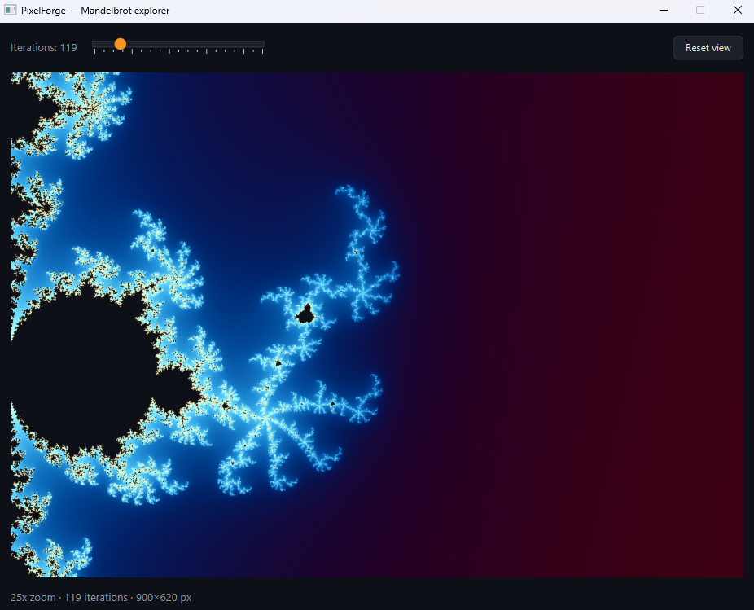

# PixelForge

> Interactive Mandelbrot explorer with off-thread rendering.




Pan, zoom and tweak iteration count with the UI staying responsive
throughout. Rendering happens on a background thread; stale renders are
cancelled the moment a new one is requested.

## Features

- Smooth-coloured Mandelbrot render on a JavaFX Canvas
- Drag to pan, scroll to zoom about the cursor
- Half-resolution preview during drag, full resolution on release
- Cancellable renders — the newest view always wins
- Iteration slider from 50 to 500
- Right-click resets to the default view

## Tech

Java 21 · JavaFX 21 · Maven · zero runtime dependencies beyond JavaFX

## Run it

**From a release** (needs Java 21+ only):

```bash
java -jar pixelforge-1.0.0-win.jar
```

[Releases page](https://github.com/vbforge/java-desktop-labs/releases/tag/pixelforge-v1.0.0)

**From source** (needs JDK 21 and Maven):

```bash
cd apps/pixelforge
mvn clean javafx:run
```

## What I learned

- **Heavy work never goes on the JavaFX Application Thread.** A 900×600
  Mandelbrot at 200 iterations is ~100 million double operations. On the
  FX thread that freezes the UI for a second or more per frame.

- **`Task<T>` is the right primitive for restartable work.** It runs
  `call()` on a background thread, delivers the result to the FX thread
  via `onSucceeded`, and gives you `cancel()` for free. The alternative —
  raw threads plus `Platform.runLater` — works but puts the
  thread-handoff discipline on you, and forgetting it produces
  `IllegalStateException: Not on FX application thread` at a random
  later moment.

- **Cancellation is cooperative.** `Task.cancel()` sets a flag and
  interrupts, but a running `call()` only stops when it checks. One
  `isCancelled()` poll per rendered row is frequent enough for
  responsive dragging and cheap enough to disappear in the noise.

- **A single-thread executor plus `cancel()` is the whole queue.**
  Cancelling the in-flight task means the queued one starts almost
  immediately, rather than after a stale render that nobody wants.

- **Preview quality during interaction pays for itself.** Rendering at
  half resolution during a drag is 4× faster, and the user can't tell
  the difference because they're moving too fast to scrutinise. The
  full-quality render fires on mouse release.

- **`WritableImage` and `PixelWriter` are thread-safe to construct and
  fill.** The image only becomes scene-graph-affine when it's drawn. So
  the renderer can produce a complete image on the background thread and
  hand it off wholesale — no partial updates, no locks.

---

## Why made such decisions

**Why `Task` and not a raw `Thread`:** raw threads give you a `Runnable` and no way to deliver the result back to the
FX thread except by calling `Platform.runLater` yourself — and if you forget, you get `IllegalStateException: Not on FX application thread` at
some unpredictable moment. `Task` makes the "result arrives on the FX thread" part structurally true.

**Why `isCancelled()` and not `Thread.interrupted()`:** `Task.cancel()` sets its own flag and *also* interrupts.
Checking `isCancelled()` is the higher-level contract and doesn't consume the interrupt status,
which matters if some future caller uses `Thread.interrupted()` themselves. It's also clearer to read.

**The `preview` flag:** while you're dragging, rendering full resolution is overkill — you can't see the detail anyway and you'd rather
have 30 fps of blurry than 1 fps of sharp. On mouse release, the final position gets a full-quality render.
This is the single biggest UX trick in any interactive renderer, and it falls out of the cancel-and-restart mechanism for free.

The `stop()` method **and** the daemon-thread factory are both there on purpose.
`stop()` is called when JavaFX shuts down, and `shutdownNow()` interrupts the render thread immediately.
The daemon flag is a belt-and-suspenders fallback for the case where `stop()` doesn't get called (crash, forced kill).
Either alone is fine; together they guarantee no zombie thread keeps the JVM alive after the window closes.

---

## License

MIT — see [LICENSE](../../LICENSE).


