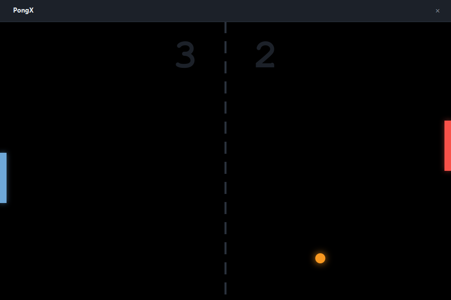
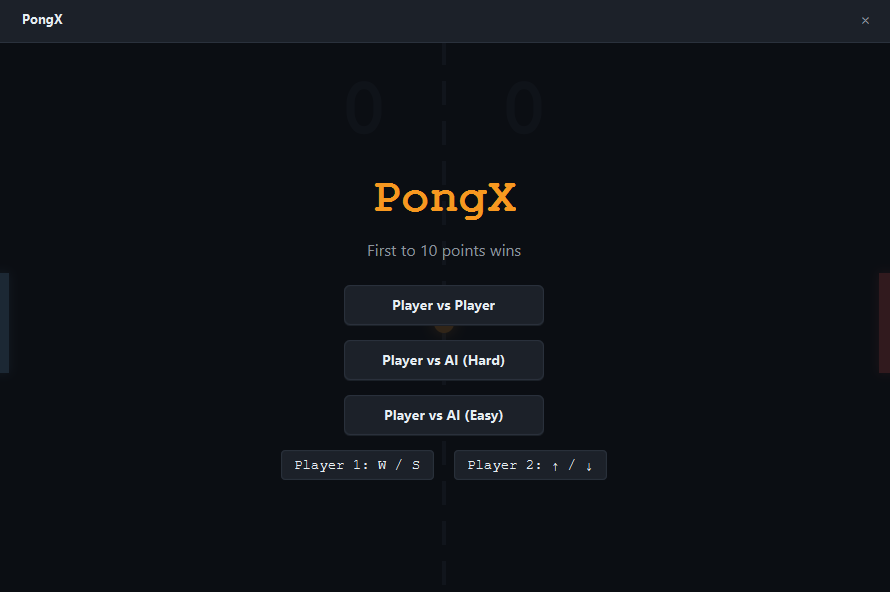

# PongX

> Classic Pong rebuilt with JavaFX, dynamic physics, and an AI opponent.





A modern take on the arcade classic. Play against a friend locally or test your skills against an AI opponent with adjustable difficulty. The game features smooth 60fps rendering, angle-based ball physics, and a sleek dark UI.

## Features

- **Player vs Player**: Local multiplayer (W/S vs ↑/↓).
- **Player vs AI**: Challenge the computer in Easy or Hard mode.
- **Dynamic Physics**: The ball's bounce angle depends on where it strikes the paddle, and its speed increases with every hit.
- **Pause & Overlays**: Press `Space` to pause. Includes Start and Game Over screens.
- **Game States**: First to 10 points wins the match.
- **Smooth Rendering**: Uses `AnimationTimer` with a `Canvas` for precise, flicker-free 60fps.
- **Unit Tested**: Core game logic is verified with JUnit 5.

## Tech

Java 21 · JavaFX 21 · JUnit 5 · Maven

## How to Play

- **Player 1**: `W` / `S`
- **Player 2**: `↑` / `↓` (or the AI controls the right paddle)
- **Pause**: `Space`

## Run it

**From a release** (needs Java 21+ only):

```bash
java -jar pongx-1.0.0-win.jar
```

**From source** (needs JDK 21 and Maven):

```bash
cd apps/pongx
mvn clean javafx:run
```

**Run the tests:**
```bash
mvn test
```

## What I learned

- **`setFocusTraversable(false)` fixes the Spacebar trap.** In JavaFX, pressing `Space` triggers the action of whichever button currently has focus. When clicking "Start Game", that button kept focus, so pressing `Space` to pause accidentally restarted the game. The fix was disabling focus on all UI buttons and explicitly requesting focus on the root pane when the game starts.

- **Angle-based bouncing makes Pong fun.** Instead of just reversing the ball's X velocity, we calculate the hit position relative to the center of the paddle. This changes the bounce angle, allowing players to aim the ball toward the corners or bounce it straight back.

- **`AnimationTimer` is superior to `Thread` for game loops.** The original Swing version used a raw `Thread` with a target of 60 ticks per second. A `Thread` will drift and cause tearing. `AnimationTimer` is tied to the JavaFX rendering pulse, guaranteeing perfectly synchronized frames.

- **Separating the engine enables testing.** Because `PongEngine` has no JavaFX dependencies, we can test collision logic, scoring, and wall bouncing with JUnit 5 without needing a display or a game loop.

## License

MIT — see [LICENSE](../../LICENSE).