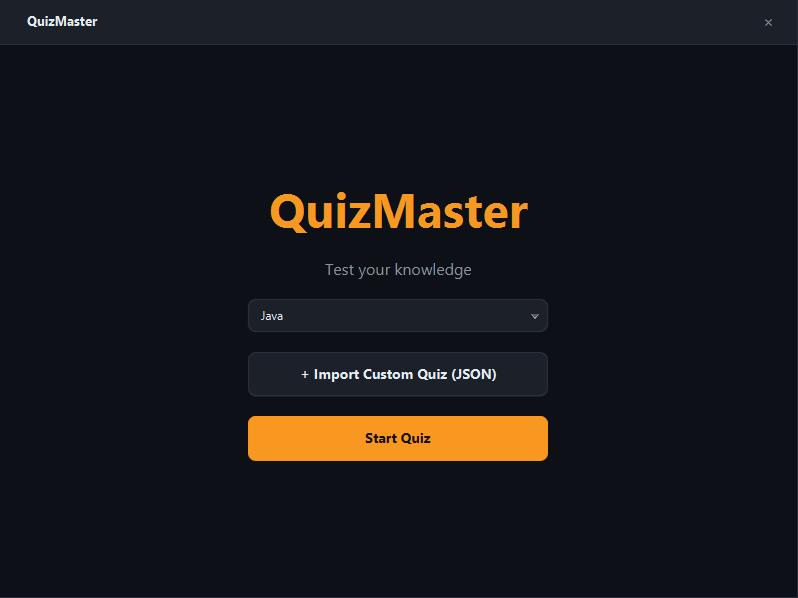

# QuizMaster

> Interactive quiz application with SQLite storage and JSON import.




Test your knowledge across multiple categories with a sleek, animated
interface. QuizMaster features a 15-second timer, shuffled questions, and
an end-of-game retrospective that shows exactly which questions you missed.

The app comes with a few seed categories, but it is designed to be easily
extended. You can drop in your own JSON files to instantly create new
quizzes.

## Features

- **Dynamic Categories**: Pick from themes like Java, Animals, or General Knowledge.
- **JSON Import**: Bring your own questions by importing a `.json` file. Duplicates are automatically ignored.
- **Smooth Timer**: A 60fps draining progress bar gives you 15 seconds per question.
- **Randomized Options**: Answer choices are shuffled every time, so "A" isn't always the right answer.
- **Retrospective**: After finishing, review every question to see what you got right (green) and wrong (red).
- **SQLite Storage**: All questions are persisted locally in `~/.quizmaster/quiz.db`.

## Tech

Java 21 · JavaFX 21 · Jackson (JSON) · SQLite JDBC · Maven

## JSON Format

To add your own questions, create a JSON file with this structure and click
**"+ Import Custom Quiz"** in the app:

```json
[
  {
    "category": "World History",
    "text": "In what year did World War II end?",
    "options": ["1942", "1945", "1950", "1939"],
    "correctIndex": 1
  }
]
```
*(Note: `correctIndex` is 0-based. 0 = A, 1 = B, 2 = C, 3 = D).*

## Run it

**From a release** (needs Java 21+ only):

```bash
java -jar quizmaster-1.0.0-win.jar
```

**From source** (needs JDK 21 and Maven):

```bash
cd apps/quizmaster
mvn clean javafx:run
```

## What I learned

- **`AnimationTimer` is better than `Timeline` for smooth progress bars.**
  A `Timeline` with a 1-second keyframe updates the UI in chunky steps.
  Using `AnimationTimer` allows us to calculate the exact delta in
  nanoseconds, resulting in a buttery-smooth 60fps draining timer.

- **JavaFX `ProgressBar` CSS is deceptive.** If you set a `ProgressBar` to a
  tiny height (like `-fx-pref-height: 6;`), the default Modena styling will
  squash the colored `.bar` to zero height, making it invisible. You have to
  explicitly set `-fx-background-insets: 0;` and `-fx-padding` on the `.bar`
  to force it to fill the track.

- **Database-level deduplication is the safest way to handle imports.**
  Instead of writing Java logic to check if a question exists, we added a
  `UNIQUE(category, text)` index to SQLite and used `INSERT OR IGNORE`. The
  database handles duplicates instantly and efficiently, even if the user
  imports the same file 100 times.

- **Shuffling options requires tracking the new index.** When you shuffle a
  list of 4 options, the correct answer moves to a new index. We saved the
  `currentShuffledCorrectIndex` to ensure the Retrospective screen still
  knows which answer was correct after the quiz ended.

- **Database migrations are critical.** When we added the `UNIQUE INDEX` to
  an existing database, SQLite threw a constraint error because of
  duplicates created in previous testing. We fixed this by running a
  `DELETE` query to clean up duplicates before creating the index.

## License

MIT — see [LICENSE](../../LICENSE).