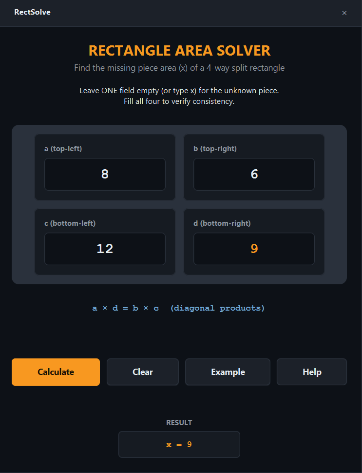

# RectSolve

> Solve for the missing area of a 4-way split rectangle using geometric invariants.




A fast, desktop utility for geometry students and professionals. When a rectangle is split into four smaller pieces by one horizontal and one vertical cut, knowing the areas of any three pieces allows you to calculate the fourth. This app does the math instantly and verifies consistency if all four are known.

## Features

- **Solve for any unknown**: Leave one field empty (or type `x`) and click Calculate.
- **Verify consistency**: Fill all four fields to check if they form a valid rectangle split.
- **Built-in Help**: A beautiful modal explains the diagonal product theorem.
- **Strict Validation**: Prevents division by zero and handles invalid number formats gracefully.
- **Modern UI**: Centered layout with the `vbforge` dark theme.

## Tech

Java 21 · JavaFX 21 · JUnit 5 · Maven

## The Math

If a rectangle is split by one horizontal and one vertical cut, the point where the cuts intersect forms a cross. The areas of the four resulting pieces follow a strict geometric invariant: **the product of the opposite diagonal areas are always equal.**

```
+---------+---------+
|    a    |    b    |
+---------+---------+
|    c    |    d    |
+---------+---------+
```

**Invariant:** `a * d = b * c`

The core logic is handled by `RectangleSolver`, a pure Java class with no UI dependencies, making it fully testable with JUnit 5.

## Run it

**From a release** (needs Java 21+ only):

```bash
java -jar rectsolve-1.0.0-win.jar
```

**From source** (needs JDK 21 and Maven):

```bash
cd apps/rectsolve
mvn clean javafx:run
```

**Run the tests:**
```bash
mvn test
```

## What I learned

- **JavaFX layout containers are powerful but opinionated.** Using a `VBox` with `Pos.TOP_CENTER` makes it incredibly easy to perfectly center a form, compared to calculating coordinates or fighting `GridPane` alignments.

- **JavaFX Modals need explicit sizing.** When building a custom `Stage` with `Modality.APPLICATION_MODAL`, the `Scene` dimensions act as a hard constraint. If you add a lot of text without setting a large enough width/height, the text gets cut off with an ellipsis (`...`).

- **`setWrapText(true)` is mandatory for dynamic text.** If a label contains a long paragraph of help text and the window is resized, `setWrapText(true)` ensures the text reflows gracefully to the next line instead of expanding the window bounds.

- **Pure math is a joy to test.** Because `RectangleSolver` has zero UI code, the JUnit tests run in milliseconds. Testing edge cases (like division by zero or invalid input combinations) is trivial and guarantees the UI never crashes from a mathematical error.

## License

MIT — see [LICENSE](../../LICENSE).