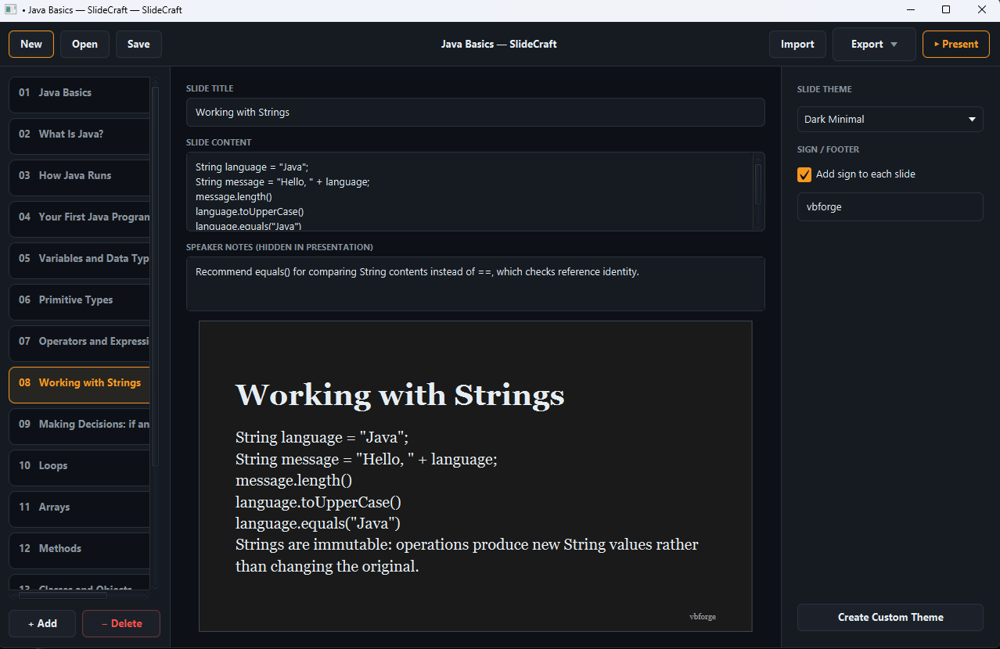

# SlideCraft

Minimalist desktop presentation editor (JavaFX 21, Java 21). You write titles and text; one theme styles every slide.




## Run / build

Requires JDK 21 and Maven 3.9+.

```bash
mvn javafx:run              # run from source
mvn verify                  # compile + unit tests + fat jar
java -jar target/slidecraft-1.0.0-all.jar [file.slidecraft]
```

The fat jar contains the JavaFX natives of the OS it was built on, so build on each target OS.
For a native installer (needs the JDK's `jpackage`):

```bash
jpackage --type app-image --name SlideCraft --input target \
  --main-jar slidecraft-1.0.0-all.jar --main-class com.vbforge.slidecraft.Launcher
```

### Tests

`mvn verify` runs all JUnit 5 tests. The PNG-rendering test needs the JavaFX toolkit; it is skipped
automatically when no display is available. To run it headless (CI):

```bash
mvn verify -Pheadless-fx
```

## Features

- 3-panel editor: slide list, title/content/notes + live preview, theme and signature panel
- Built-in themes (Vibrant Blue, Dark Minimal, Clean Light, Neon Cyberpunk) and custom themes
  saved to `~/.slidecraft/themes/`
- New / Open / Save / Save As with unsaved-changes prompts; Import with strict validation
- Export: PDF, TXT, Markdown, PNG (current slide or all slides, 1920x1080), `.slidecraft` JSON
- Presentation-wide signature stamped bottom-right in preview, presentation and every export
- Fullscreen presentation with sliding transitions (arrows, Space, Page keys, click left/right edge, Esc exits)
- Shortcuts: Ctrl/Cmd+N, O, S, Shift+S, F5 (present)

## File format

```json
{
  "title": "My Deck",
  "theme": { "name": "Vibrant Blue", "backgroundColor": "#095be0", "textColor": "#ffffff",
             "fontFamily": "System", "textAlignment": "CENTER" },
  "sign": { "enabled": true, "text": "© 2026 Your Name" },
  "slides": [ { "title": "Welcome", "content": "Hello", "notes": "" } ]
}
```

Import rules: root must be an object; `slides` a non-empty array of objects; slide fields are coerced to
text; `theme`/`sign`/`title` are optional (defaults: Dark Minimal, no sign, "Untitled Presentation");
unknown fields are ignored. An invalid file is rejected as a whole.

## Design notes

- `render.SlideView` is the single renderer (fixed 1920x1080 layout). Preview and presentation scale it
  (`SlideCanvas`); PNG and PDF snapshot it (`SlideSnapshot`), so all outputs look the same.
- PDF export embeds the rendered slide image on 16:9 pages (PDFBox). This gives exact theme/font parity and
  no white margins, but PDF text is not selectable.
- `Theme` validates colours, font and alignment in its constructor, so imported or hand-edited files can't
  inject anything into the inline CSS used for styling.
- Files are written atomically (temp file + move).
- Window uses the OS title bar rather than a custom-drawn one.
