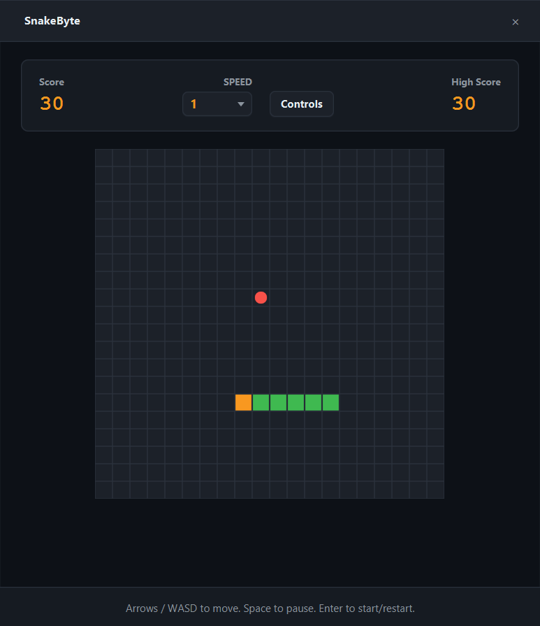

# SnakeByte

> Classic Snake rebuilt with JavaFX, customizable controls, and speed settings.




A modern take on the arcade classic. Eat the apples, grow your snake, and
try not to hit the walls or your own tail. The game features a smooth 60fps
rendering loop, speed scaling from casual to lightning-fast, and the ability
to completely remap your directional keys.

## Features

- **Smooth Canvas Rendering**: Uses `AnimationTimer` for precise, frame-by-frame movement.
- **Dynamic Speed**: Choose from 5 different speed levels. You can even change the speed mid-game!
- **Custom Keybindings**: Don't like the arrow keys? Rebind Up, Down, Left, and Right to any key (WASD, IJKL, etc.) via the Controls menu.
- **Pause Overlay**: Press `Space` to pause the game at any time.
- **Game Over Screen**: Instantly restart without closing the app.
- **Unit Tested**: The core game engine is fully isolated and tested with JUnit 5.

## Tech

Java 21 · JavaFX 21 · JUnit 5 · Maven

## How to Play

- Use **Arrow Keys** (or your custom keybindings) to steer the snake.
- Eat the **Red Apples** to grow and increase your score.
- Press **Space** to Pause / Resume.
- Press **Enter** to Start / Restart.
- Click **Controls** to remap your directional keys.

## Run it

**From a release** (needs Java 21+ only):

```bash
java -jar snakebyte-1.0.0-win.jar
```

**From source** (needs JDK 21 and Maven):

```bash
cd apps/snakebyte
mvn clean javafx:run
```

**Run the tests:**
```bash
mvn test
```

## What I learned

- **`AnimationTimer` vs `Timeline` for Game Loops.** A `Timeline` with keyframes
  is good for UI animations, but a game loop requires absolute precision.
  `AnimationTimer` gives you the exact nanosecond timestamp of the current frame,
  allowing you to calculate tick rates and animations without drift.

- **The Spacebar trap.** In JavaFX, pressing Space triggers the action of whatever
  button currently has focus. When the user clicked "Start Game", the button kept
  focus. Pressing Space to pause accidentally restarted the game. The fix was
  calling `setFocusTraversable(false)` on the button and consuming the Space key
  event in the scene's key listener.

- **Styling a `ComboBox` Popup is surprisingly deep.** You cannot just style
  `.combo-box`. The actual dropdown menu is a separate popup window rendered
  with a `ListView`. To make it dark, you must target `.combo-box-popup .list-view`,
  its internal `.virtual-flow`, `.clipped-container`, and explicitly override
  `-fx-control-inner-background`.

- **Storing Keybindings cleanly.** Instead of a massive `if/else` chain for keys,
  using an `EnumMap<Direction, KeyCode>` makes it trivial to remap keys dynamically
  and check inputs cleanly in the game loop.

## License

MIT — see [LICENSE](../../LICENSE).