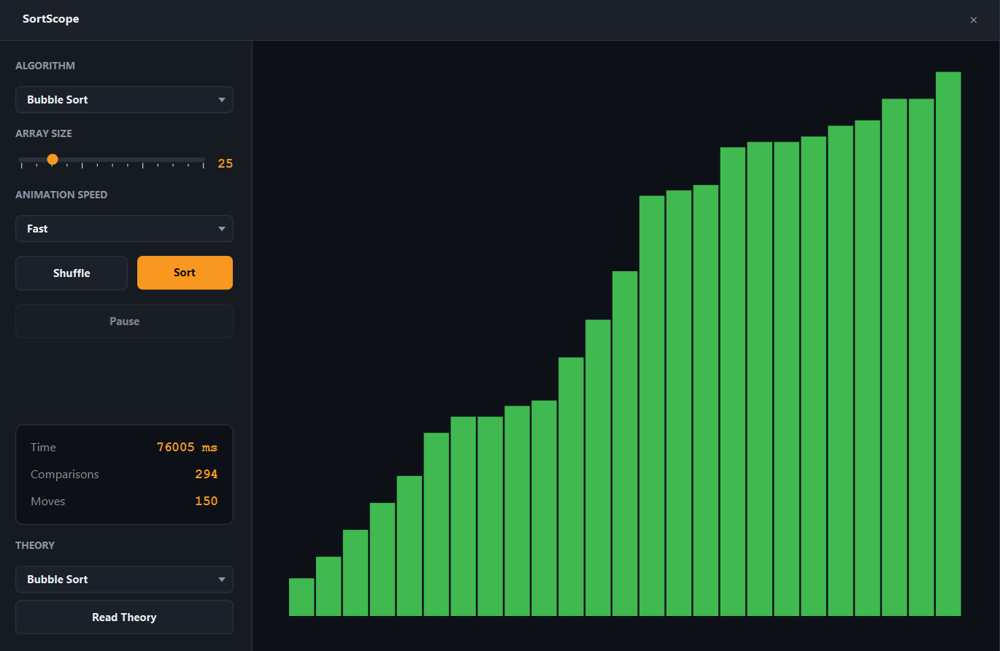
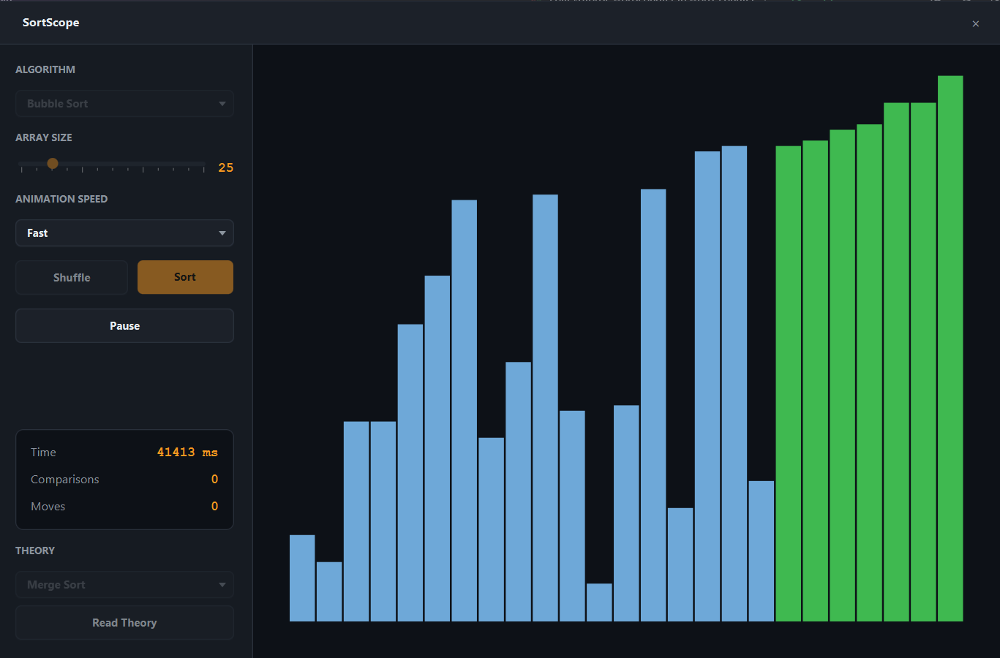
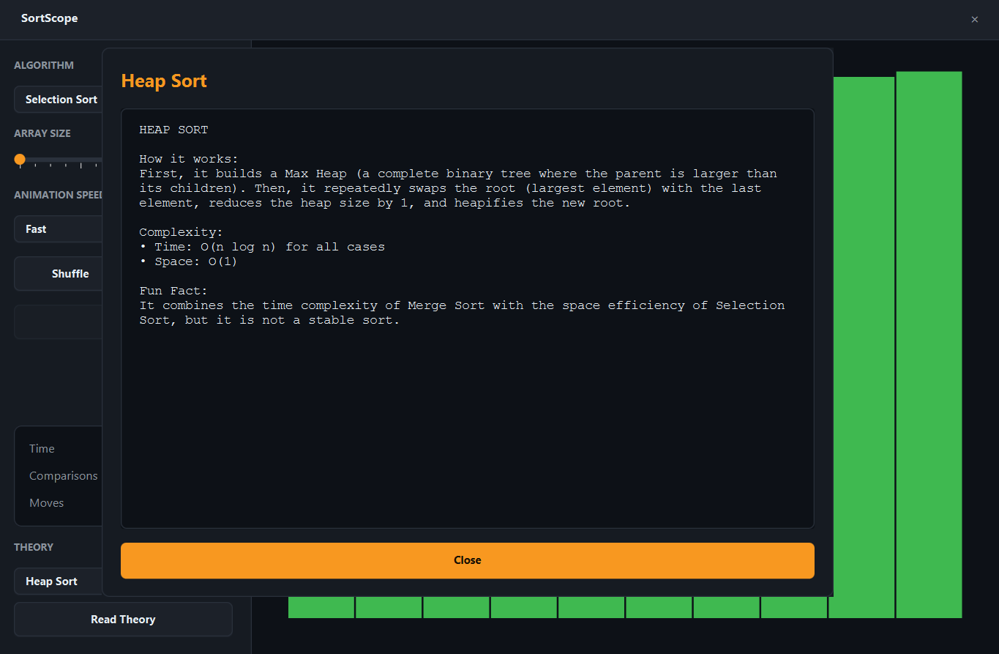

# SortScope

> Visualize classic sorting algorithms with real-time stats and theory explanations.






An interactive educational tool for exploring how sorting algorithms work under the hood. Watch the bars animate as they swap, track real-time comparisons and moves, and read up on the time and space complexity of each algorithm.

## Features

- **6 Algorithms**: Bubble, Selection, Insertion, Merge, Quick, and Heap Sort.
- **Live Statistics**: Tracks Time (ms), Comparisons, and Moves (Swaps + Writes) in real-time.
- **Dynamic Array Size**: Generate arrays from 10 to 100 elements.
- **Speed Control**: Adjust the animation speed from Slow to Instant.
- **Pause/Resume**: Freeze the animation at any point to inspect the current state.
- **Theory Section**: Built-in modal windows explaining how each algorithm works and its Big-O complexity.
- **Unit Tested**: The core sorting logic is verified with JUnit 5.

## Tech

Java 21 · JavaFX 21 · JUnit 5 · Maven

## The Architecture

The project uses a highly decoupled architecture:
1. **`AbstractSort`**: A base class containing helper methods for generating color transitions and swap animations.
2. **Algorithm Classes**: Each algorithm implements `startSort()`, which mutates the underlying `CNode[]` array and returns a list of JavaFX `Transition` objects.
3. **`SortScopeApp`**: The UI layer. It wraps the returned transitions in a `SequentialTransition` and plays them, updating the stats panel independently via a `Timeline`.

### A note on "Moves"
Merge Sort does not swap elements in-place; it overwrites them using a temporary array. To keep the statistics fair across all algorithms, we count **"Moves"** (which includes both swaps and array writes) instead of just "Swaps".

## Run it

**From a release** (needs Java 21+ only):

```bash
java -jar sortscope-1.0.0-win.jar
```

**From source** (needs JDK 21 and Maven):

```bash
cd apps/sortscope
mvn clean javafx:run
```

**Run the tests:**
```bash
mvn test
```

## What I learned

- **Separating logic from animation is powerful.** Because the algorithms are pure Java and return a list of `Transition` objects, the UI thread never blocks. The UI simply plays the transitions, while the algorithms mutate the array synchronously.

- **Styling JavaFX `ComboBox` and `TextArea` is notoriously difficult.** To fully dark-theme a `ComboBox` popup, you must target internal classes like `.virtual-flow` and `.clipped-container`. For `TextArea`, you must override `-fx-control-inner-background` and `.content` to avoid white flashes.

- **`Platform.startup()` is required for testing JavaFX nodes.** Because `CNode` extends `Rectangle`, initializing it in a JUnit test throws a "Toolkit not initialized" exception. Calling `Platform.startup()` in a `@BeforeAll` block solves this, allowing the pure logic to be tested headlessly.

- **Bubble Sort early-exit optimization requires careful state tracking.** Checking a boolean `swapped` flag *after* the inner loop is the only way to break out early if the array is already sorted, reducing the best-case time complexity from O(n²) to O(n).

## License

MIT — see [LICENSE](../../LICENSE).