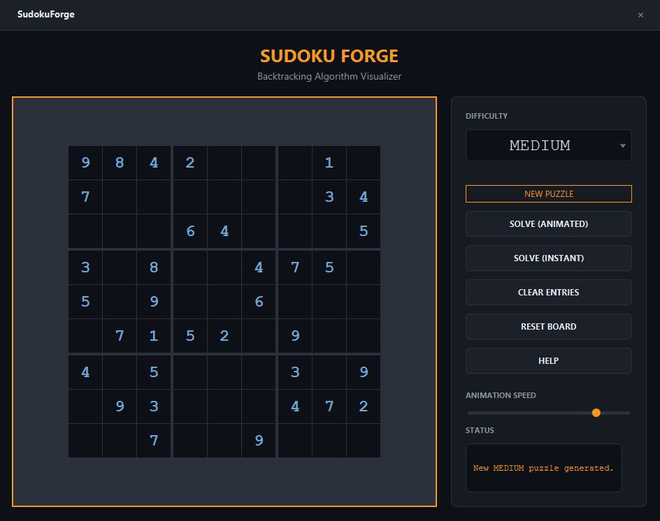

SudokuForge

> Sudoku generator and animated backtracking solver visualizer.




A sleek, dark-themed Sudoku application that not only lets you play but also visualizes the raw computational effort required to solve the puzzle. Generate boards across four difficulties and watch the algorithm try, place, and backtrack in real-time.

## Features

- **Puzzle Generator**: Creates uniquely solvable puzzles from EASY to EXPERT.
- **Animated Solver**: Visualizes the recursion tree (trying numbers, placing them, and backtracking) with adjustable speed.
- **Instant Solver**: Solves the current board immediately.
- **Manual Play**: Click any empty cell and type a number (or click to cycle 0-9) to play manually.
- **Smart Reset**: "Clear Entries" wipes your manual inputs but keeps the original puzzle; "Reset Board" restores the exact state from generation.
- **Help Modal**: Built-in explanation of the Backtracking algorithm and color legend.
- **JUnit 5 Tested**: Core logic is verified for speed and correctness.

## Tech

Java 21 · JavaFX 21 · JUnit 5 · Maven

## The Backtracking Algorithm

This app uses a classic recursive backtracking algorithm. Time complexity is O(9^N) where N is the number of empty cells, and space complexity is O(N).

To make the animation smooth and non-blocking:
1. The solver runs on a background `Task`.
2. Every step (`TRY`, `PLACE`, `BACKTRACK`) is recorded as a `StepEvent` and stored in a list.
3. Once the background thread finishes computing the full path, an `AnimationTimer` plays the events back frame-by-frame on the UI thread based on the slider's speed.

## Run it

**From a release** (needs Java 21+ only):

```bash
java -jar sudokuforge-1.0.0-win.jar
```

**From source** (needs JDK 21 and Maven):

```bash
cd apps/sudokuforge
mvn clean javafx:run
```

**Run the tests:**
```bash
mvn test
```

## What I learned

- **CSS `:nth-child` doesn't work in JavaFX `GridPane`.** To create perfect thick 3x3 borders, I had to nest three `GridPane`s horizontally and vertically. The outer grid uses a 4px gap with a blue background, while the inner grids use a 1px gap with a dark background.
- **`Task` + `AnimationTimer` is the ultimate combo for animation.** If you use `Thread.sleep` inside a loop on a background thread to drive UI updates, the animation can stutter due to OS scheduling. By pre-computing all the steps into a `List`, the `AnimationTimer` can play them back at a perfect 60fps, only limited by the frame rate.
- **A solver can freeze a test suite.** Testing an unsolvable, mostly-empty board with backtracking takes too long because the algorithm tries millions of permutations. The test was fixed by using a nearly-complete board that fails on the very first empty cell, keeping the test suite green and instant.

## License

MIT — see [LICENSE](../../LICENSE).