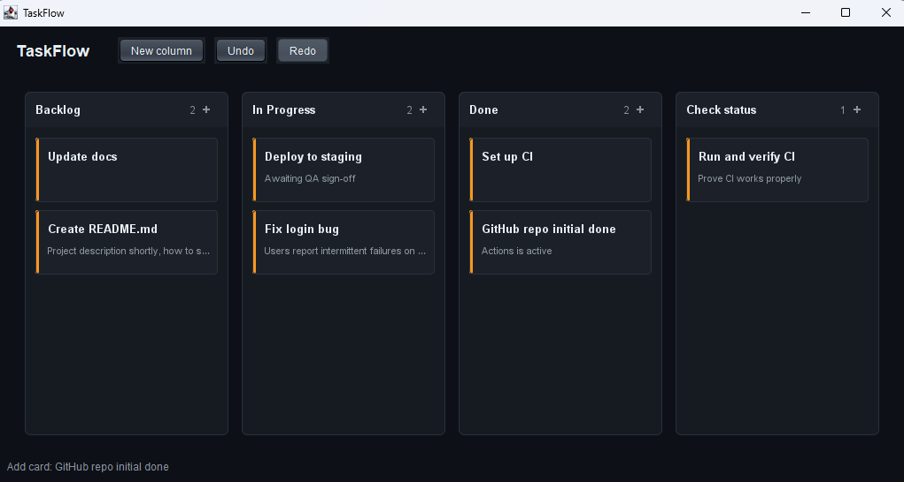
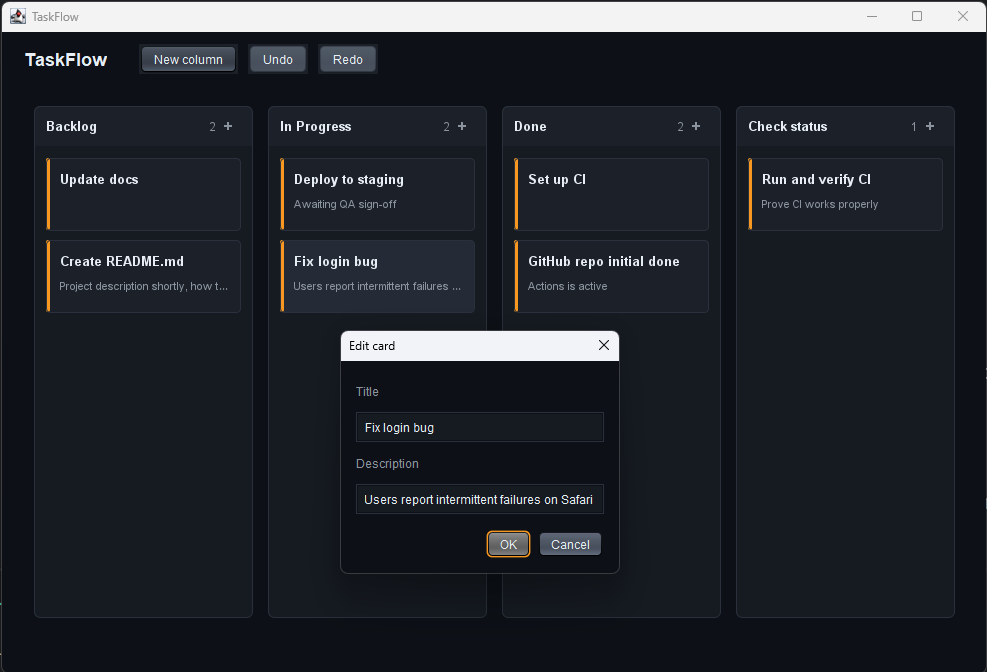
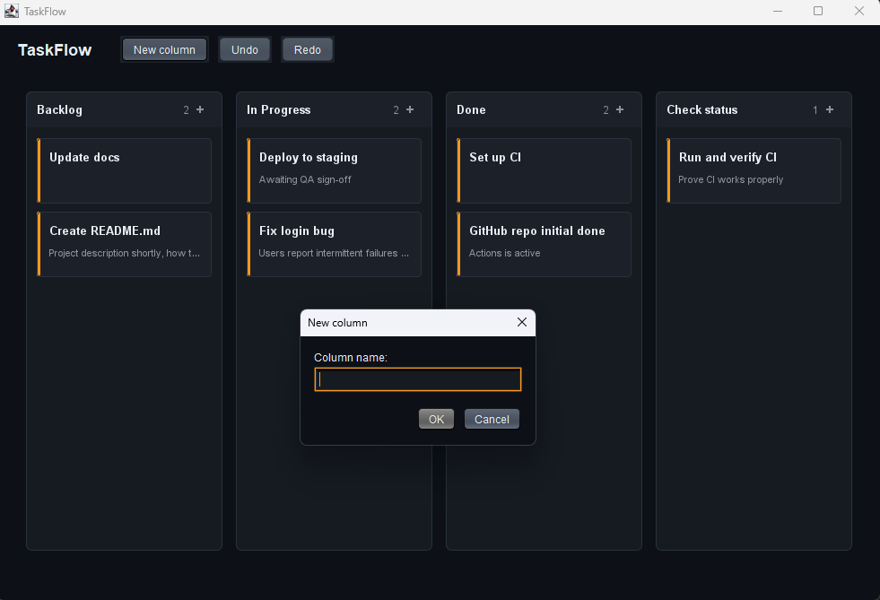

# TaskFlow

> Offline Kanban board with drag-and-drop and undo/redo.






A three-column Kanban board that lives entirely on your machine. Drag
cards between columns, edit them in place, and undo anything you didn't
mean to do. Data is a plain text file you can read and edit by hand.

## Features

- Drag cards between columns with a live drop indicator
- Custom-painted board — no third-party UI library
- Full undo/redo via the command pattern (**Ctrl/Cmd+Z**, **Ctrl/Cmd+Y**)
- Add, edit, and delete cards and columns
- Persisted to `~/.taskflow/board.tsv` — plain text, safe to inspect
- Platform-correct keyboard shortcuts (Cmd on macOS, Ctrl elsewhere)

## Tech

Java 21 · Swing · Maven · zero runtime dependencies

Custom drag-and-drop rather than `TransferHandler`. The built-in handler
is fine for file drops, but it fights you when you want a placeholder in
the source column, a live drop indicator, and a shadow under the dragged
card. Doing it with `MouseListener` plus a painted overlay is more code
but yields a much better drag experience.

## Run it

**From a release** (needs Java 21+):

```bash
java -jar taskflow-1.0.0.jar
```

[Releases page](https://github.com/vbforge/java-desktop-labs/releases/tag/taskflow-v1.0.0)

Same jar works on every platform.

**From source:**

```bash
cd apps/taskflow
mvn clean compile exec:java
```

## Where the board lives

```
Windows:  C:\Users\<you>\.taskflow\board.tsv
macOS:    /Users/<you>/.taskflow/board.tsv
Linux:    /home/<you>/.taskflow/board.tsv
```

Field separator is ASCII Unit Separator (`U+001F`) — a control character
specifically intended for this and impossible to type in the UI, so no
quoting rules are needed. Delete the file to reset to the seeded board.

## The command pattern

Every mutation to the board is a `Command` with `execute()` and `undo()`:

```java
public interface Command {
    void execute();
    void undo();
    String label();
}
```

`CommandStack` is a pair of deques:

- **execute** pushes onto the undo stack and clears the redo stack
- **undo** pops from undo, reverses the command, pushes to redo
- **redo** pops from redo, re-runs the command, pushes back to undo

Adding a new operation means adding one class. The stack doesn't change.

## What I learned

- **`TransferHandler` is the wrong tool for board-style drag-and-drop.**
  It's designed for cross-application data transfer, with `DataFlavor`
  negotiation and a fixed drag image. What a Kanban board needs is a live
  cursor-following card, a dashed placeholder in the source column, and a
  drop indicator line — all of which require custom painting during the
  drag. `MouseListener` + `MouseMotionListener` + `paintComponent` gives
  full control and less ceremony overall.

- **The command pattern turns undo/redo into a two-stack problem.**
  Before commands, "undo" means tracking what changed, in what order,
  and reverse-engineering the previous state. After commands, it's
  `undoStack.push(c)` and `redoStack.clear()`. Every operation gets an
  inverse for free.

- **Hit-testing is the cost of custom painting.** Real Swing components
  hit-test themselves. Once the board is one big canvas, "which card is
  under the mouse?" becomes arithmetic: `columnIndexAt(mx)` then
  `cardIndexAt(my)`. Worth it for the visual control, but you have to be
  disciplined about keeping the layout maths in one place.

- **`U+001F` is the right separator for a hand-rolled text format.**
  Tab and pipe can appear in user input, forcing escaping rules. The
  ASCII Unit Separator was designed for exactly this use and will never
  appear in a card title. Zero escaping, zero ambiguity.

- **`getMenuShortcutKeyMaskEx()` gives you the platform-correct modifier.**
  Hardcoding `CTRL_DOWN_MASK` produces a Cmd-Z shortcut on macOS that
  looks like a Linux import. One line, real platform fidelity.

- **Painting during a drag needs a shadow.** A card that follows the
  cursor with a soft shadow reads as "lifted off the surface." The same
  card without a shadow reads as "stuck to the cursor." It's a small
  visual detail that changes the whole feel of the interaction.

## License

MIT — see [LICENSE](../../LICENSE).