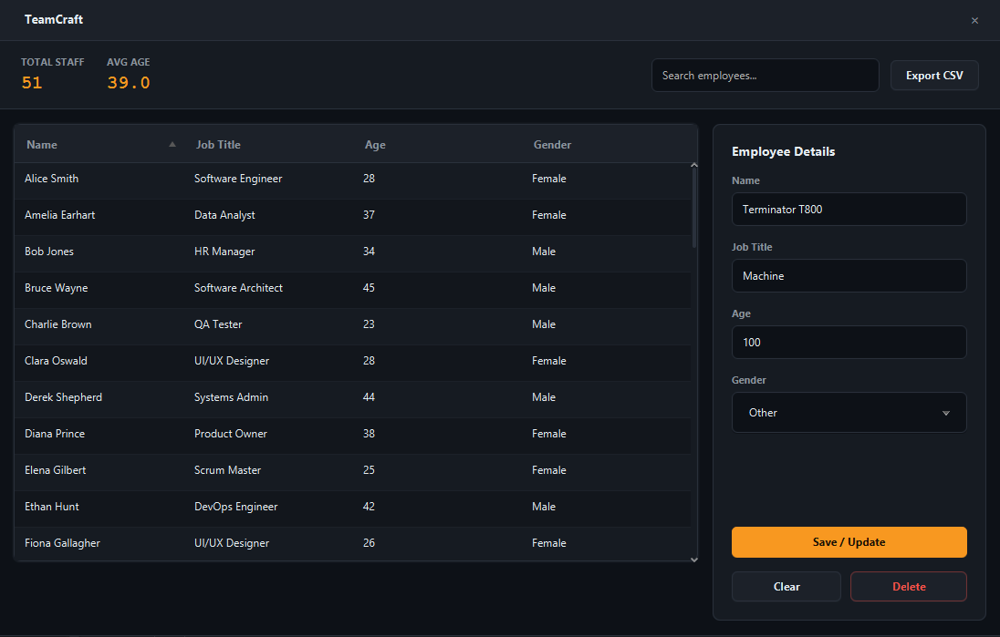

# TeamCraft

> A modern employee management system with SQLite persistence, CSV export, and live dashboard stats.




A complete CRUD application for managing team members. It replaces the original JFoenix prototype with a robust SQLite backend, instant search, sortable columns, and the signature `vbforge-style` dark UI.

## Features

- **Full CRUD**: Create, Read, Update, and Delete employees.
- **SQLite Persistence**: All data is saved to `~/.teamcraft/teamcraft.db`.
- **Live Dashboard**: A top header shows the total staff count and average age, updating instantly as you search or filter.
- **Instant Search**: Filter by name, job title, or gender.
- **Sortable Columns**: Click any table header to sort alphabetically or numerically.
- **CSV Export**: Export the current (filtered) table view to a `.csv` file for HR reporting.
- **Form Validation**: Rejects empty fields and enforces a realistic age range (16–100).
- **Unit Tested**: DAO logic is verified with JUnit 5 using an in-memory SQLite database.

## Tech

Java 21 · JavaFX 21 · SQLite (via `sqlite-jdbc`) · JUnit 5 · Maven

## The Architecture

The project strictly separates concerns:
1. **`Employee`**: A simple `record` holding the domain data.
2. **`Db`**: Handles connection and schema creation. Can accept `:memory:` for testing.
3. **`EmployeeDao`**: All SQL queries (SELECT, INSERT, UPDATE, DELETE) are handled here using `PreparedStatement`.
4. **`TeamCraftApp`**: The JavaFX UI. Uses `FilteredList` + `SortedList` to handle instant search and click-to-sort columns simultaneously.

## Run it

**From a release** (needs Java 21+ only):

```bash
java -jar teamcraft-1.0.0-win.jar
```

**From source** (needs JDK 21 and Maven):

```bash
cd apps/teamcraft
mvn clean javafx:run
```

**Run the tests:**
```bash
mvn test
```

## What I learned

- **`FilteredList` + `SortedList` is the correct pattern for search + sort.** Binding a `SortedList.comparatorProperty()` directly to a `TableView.comparatorProperty()` means the UI handles sorting natively, while the `FilteredList` handles search. They work together without ever needing to manually sort the data in the DAO.

- **`TextFormatter` for numeric input.** To prevent users from typing letters into the Age field, we used a `TextFormatter` with a regex (`\\d{0,3}`). This stops invalid input before it even hits the text field, rather than checking it on submission.

- **`PreparedStatement` is non-negotiable.** Even though this is a local desktop app, using `PreparedStatement` everywhere prevents SQL injection and protects against names with apostrophes (like "O'Brien"), which would break a normal `Statement`.

- **`:memory:` for testing SQLite.** Passing `:memory:` as the database path creates a temporary database that lives only in RAM. It's destroyed when the connection closes, making DAO tests lightning-fast and perfectly isolated from the developer's real data.

## License

MIT — see [LICENSE](../../LICENSE).