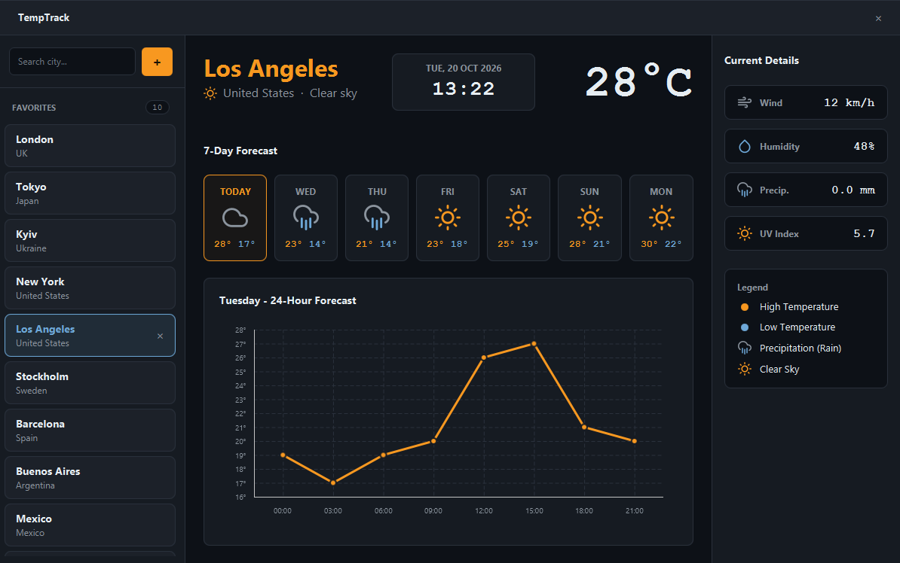

# TempTrack

> A modern weather dashboard with a 7-day forecast, interactive hourly charts, and SQLite-saved favorite cities.




A desktop weather tracker that lets you build a list of favorite cities and see live conditions for any of them in one click. It uses the free Open-Meteo API (no API key needed), stores your cities locally in SQLite, and wraps everything in the signature `vbforge-style` dark UI.

## Features

- **City Search**: Type any city name; it is geocoded through Open-Meteo and added to your favorites.
- **SQLite Persistence**: Favorite cities are saved to `~/.temptrack/temptrack.db` and restored on every launch.
- **7-Day Forecast**: Clickable day cards with high/low temperatures and a weather icon for each day.
- **Hourly Chart**: Selecting a day redraws a 24-hour temperature line chart (3-hour steps) with hover tooltips.
- **Current Details**: Wind, humidity, precipitation, and UV index for the selected city.
- **Local City Clock**: A live clock and date shown in the *selected city's* time zone, not yours.
- **Vector Weather Icons**: Sun, clouds, rain, snow, fog, and storms drawn with JavaFX shapes, colored entirely from CSS.
- **Favorites Management**: Hover or select a city card to remove it. Duplicate cities are detected and simply selected.
- **Stable Layout**: Long city names are shortened with an ellipsis and a tooltip, so the window never shifts.

## Tech

Java 21 · JavaFX 21 · SQLite (via `sqlite-jdbc`) · Jackson · Open-Meteo REST API · JUnit 5 · Maven

## The Architecture

The project keeps data, network, and UI separate:
1. **`City`**: A simple `record` holding the saved city data.
2. **`CityDao`**: All SQL for the favorites table, using `PreparedStatement`. Accepts `:memory:` for testing.
3. **`WeatherEngine`**: Talks to the Open-Meteo geocoding and forecast endpoints. JSON parsing is a separate method, so it can be tested without network access.
4. **`WeatherData`**: Immutable model for current conditions, daily and hourly forecasts.
5. **`WeatherIcons`**: Builds the weather icons from `SVGPath` shapes. Colors come from `temptrack.css`.
6. **`TempTrackApp`**: The JavaFX UI. Network calls run in background `Task`s so the window never freezes.

## Run it

**From a release** (needs Java 21+ only):

```bash
java -jar temptrack-1.0.0-win.jar
```

**From source** (needs JDK 21 and Maven):

```bash
cd apps/temptrack
mvn clean javafx:run
```

**Run the tests:**
```bash
mvn test
```

## What I learned

- **JavaFX does not render color emoji reliably.** Emoji come out as flat gray glyphs or empty boxes depending on the OS and font. Drawing the icons as `SVGPath` shapes and coloring them from CSS gives the same result on every platform and keeps the palette in one place.

- **`String.format` depends on the system locale.** On a Ukrainian locale, `%f` prints `50,45` with a comma, which silently breaks the API URL. Passing `Locale.ROOT` for anything that goes into a URL or a file fixes it.

- **Async responses can arrive out of order.** Clicking through cities quickly started several requests, and a slow one could overwrite the newer city's data. A simple request counter checked in `setOnSucceeded` drops stale responses.

- **Labels do not inherit text color from their parent.** A `-fx-text-fill` on a `ListCell` or `HBox` does nothing for the `Label` inside it, which produced black-on-dark text. Style the labels themselves.

- **`timezone=auto` returns the city's UTC offset.** Storing `utc_offset_seconds` makes it easy to show the local time of the city you are looking at, and to pick the current hour from the hourly arrays instead of the first element.

- **Extract parsing for testing.** Keeping `parseWeatherJson()` separate from the HTTP call means the forecast logic can be tested with a sample JSON string, and `:memory:` SQLite does the same for the DAO.

## License

MIT — see [LICENSE](../../LICENSE).