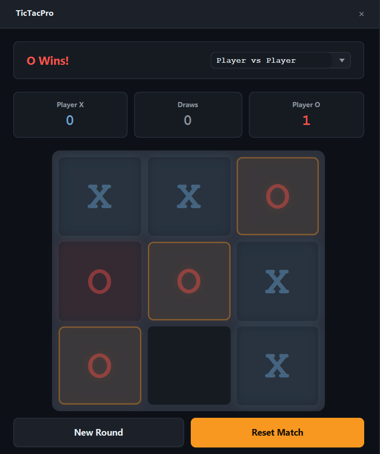

# TicTacPro

> Classic Tic-Tac-Toe rebuilt with an Unbeatable Minimax AI and a sleek dark UI.




A polished desktop version of the classic game. Play against a friend locally,
or challenge the computer. The AI comes in two flavors: an "Easy" mode that
plays randomly, and an "Unbeatable" mode that uses the Minimax algorithm to
guarantee it never loses.

## Features

- **Unbeatable AI**: Implements the Minimax algorithm with alpha-beta pruning.
- **Easy AI**: A randomized opponent for casual play.
- **Player vs Player**: Pass-and-play mode for two humans.
- **Scoreboard**: Tracks Wins, Losses, and Draws across multiple rounds.
- **Modern UI**: Dark theme with custom title bar, glowing X/O marks, and smooth animations.
- **Unit Tested**: The game engine is fully verified with JUnit 5.

## Tech

Java 21 · JavaFX 21 · JUnit 5 · Maven

## The Architecture

The project strictly separates the game logic from the UI:

1. **`TicTacToeEngine`**: A pure Java class with zero JavaFX dependencies.
   It handles the board state, win/draw detection, and the Minimax AI. Because
   it's decoupled, it runs in milliseconds during JUnit tests.
2. **`TicTacProApp`**: The JavaFX UI. It listens for clicks, queries the engine
   for the next best move, and updates the visual grid.

### How Minimax Works
The Minimax algorithm simulates every possible future move. It assigns a score
to each outcome (+10 for an AI win, -10 for a human win, 0 for a draw) and
assumes the human will always make the best possible move. By exploring the
tree, the AI can always choose the path that leads to the best guaranteed outcome.

## Run it

**From a release** (needs Java 21+ only):

```bash
java -jar tic-tac-pro-1.0.0-win.jar
```

**From source** (needs JDK 21 and Maven):

```bash
cd apps/tic-tac-pro
mvn clean javafx:run
```

**Run the tests:**
```bash
mvn test
```

## What I learned

- **`BorderPane` is the best layout for locking UI sections.** My first attempt
  used a `VBox`, which caused the buttons to get pushed off-screen when the
  board expanded. Switching to a `BorderPane` (top, center, bottom) guarantees
  the scoreboard stays at the top and the buttons stay at the bottom, no matter
  how the window is resized.

- **AI needs to be cancelled on reset.** The AI uses a `PauseTransition` to
  simulate thinking time. If the user clicked "New Round" before the AI finished
  thinking, the AI would place its move on the *new* board. By keeping a reference
  to the `PauseTransition` and calling `.stop()` in the reset method, we prevent
  this race condition.

- **Minimax is elegant, but brittle without a depth penalty.** If you don't
  subtract the search depth from the score, the AI will choose the longest path
  to victory instead of the fastest one (it tries to delay the inevitable).
  By scoring `10 - depth`, we force the AI to win as quickly as possible.

- **CSS `dropshadow` is perfect for glowing effects.** Instead of loading image
  assets for the X and O, we just use a text label and apply a
  `dropshadow(gaussian, ...)` via CSS. It creates a beautiful, lightweight glow
  that matches the color of the player.

## License

MIT — see [LICENSE](../../LICENSE).