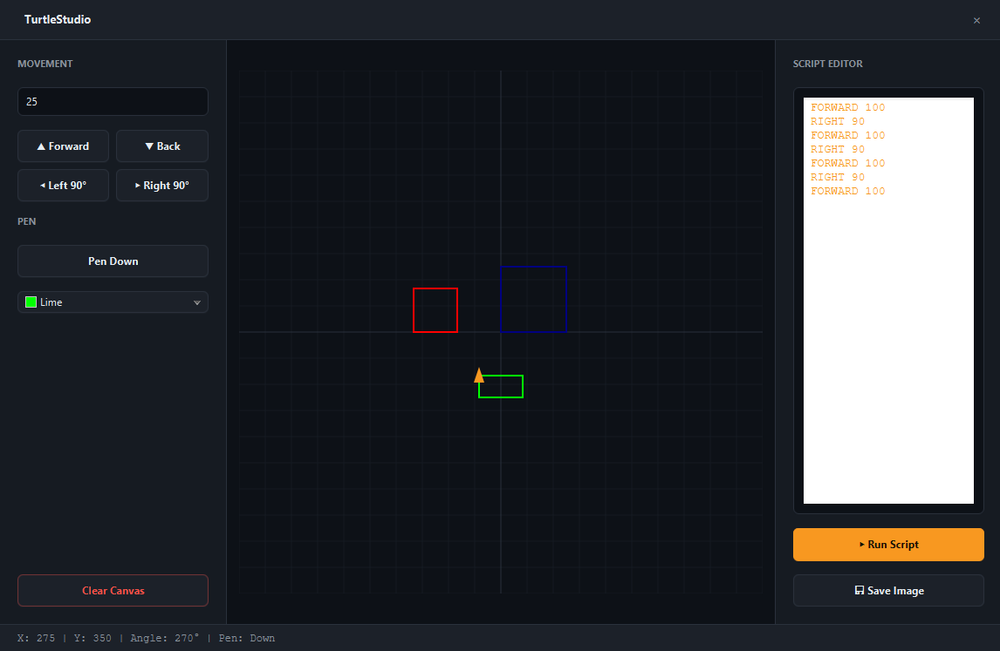

# TurtleStudio

> Interactive turtle graphics and geometry studio.




A modern take on the classic Logo programming language. Drive a virtual turtle around a Cartesian grid to draw geometric shapes, or write simple scripts to generate complex algorithmic art. The app features a smooth, animated execution engine and allows you to export your creations as PNG images.

## Features

- **Manual Control**: Move the turtle forward/back and turn left/right using the UI buttons or keyboard.
- **Pen & Color Toggle**: Lift the pen to move without drawing, and select custom colors.
- **Scripting Engine**: Write text commands (`FORWARD 100`, `RIGHT 90`, `PEN UP`, etc.) to automate drawing.
- **Animated Execution**: Watch the turtle execute your script step-by-step with a clean visual timeline.
- **Export to PNG**: Save your drawings directly to your local disk.
- **Cartesian Grid**: A subtle grid helps visualize coordinates and angles.
- **JUnit 5 Tested**: Core math and the command parser are verified for accuracy.

## Tech

Java 21 · JavaFX 21 · Canvas · JUnit 5 · Maven

## The Scripting Language

TurtleStudio uses a minimal, line-by-line command language:

| Command | Description |
|---|---|
| `FORWARD <num>` | Moves the turtle forward by `num` pixels |
| `BACK <num>` | Moves the turtle backward by `num` pixels |
| `LEFT <num>` | Rotates the turtle left by `num` degrees |
| `RIGHT <num>` | Rotates the turtle right by `num` degrees |
| `PEN UP` / `PEN DOWN` | Toggles drawing |
| `CLEAR` | Clears the canvas and resets the turtle |

*(Note: You can also use `F`, `B`, `L`, `R` as shortcuts).*

## Run it

**From a release** (needs Java 21+ only):

```bash
java -jar turtlestudio-1.0.0-win.jar
```

**From source** (needs JDK 21 and Maven):

```bash
cd apps/turtlestudio
mvn clean javafx:run
```

**Run the tests:**
```bash
mvn test
```

## What I learned

- **Canvas rendering requires manual management.** Unlike the JavaFX Scene Graph (where you add `Line` or `Rectangle` nodes and the framework handles redrawing), a `Canvas` is a bitmap. Every time the turtle moves, we must call `gc.clearRect()` and redraw the entire grid, all lines, and the turtle itself. At 600x600 pixels with a few hundred lines, this is incredibly fast, but it teaches the fundamentals of game-loop rendering.
- **Exporting a Canvas requires `SwingFXUtils`.** JavaFX's `WritableImage` cannot be written to disk directly via `ImageIO`. To save the drawing, we take a `canvas.snapshot()`, convert it to a `BufferedImage` using `SwingFXUtils.fromFXImage()`, and then let Java's standard `ImageIO` write the PNG.
- **Scripting requires robust parsing.** The `CommandParser` splits text by lines and spaces. It must handle trailing spaces, blank lines, and invalid inputs gracefully. Throwing a descriptive `IllegalArgumentException` with the exact line number makes the UI much more user-friendly when the script fails.
- **`Timeline` is perfect for step-by-step animation.** Instead of manually calculating thread sleeps, we create a `Timeline` with a `KeyFrame` for each command. This allows JavaFX to handle the timing smoothly on the UI thread while ensuring the state updates exactly once per frame.

## License

MIT — see [LICENSE](../../LICENSE).