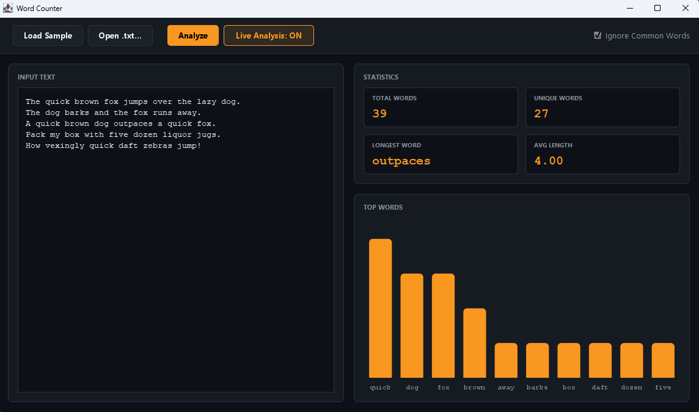

# Word Counter

> Analyze text with live updates and visual charts.




A fast, desktop text analyzer. Paste text, load a file, or just type, and
watch the statistics and bar chart update in real-time. Built with Swing
and JFreeChart.

## Features

- **Live Analysis**: Toggle "Live Analysis" and the app updates as you type (with a 300ms debounce).
- **Ignore Common Words**: Filter out "the", "and", "a" to see your actual vocabulary.
- **Visual Chart**: A dark-themed bar chart showing the top 10 most frequent words.
- **Dark UI**: Matches the FocusSprint theme with a custom Nimbus setup.
- **Unit Tested**: Core logic is verified with JUnit 5.

## Run it

**From a release** (needs Java 21+):
```bash
java -jar word-counter-1.0.0.jar
```

**From source** (needs JDK 21 and Maven):
```bash
cd apps/word-counter
mvn clean compile exec:java
```

**Run the tests:**
```bash
mvn test
```

## What I learned

- **`DocumentListener` needs debouncing.** If you analyze on every keystroke, the app lags while typing. Using a `javax.swing.Timer` that resets on every keystroke ensures the analysis only runs after the user stops typing for 300ms.

- **JFreeChart requires deep styling for dark mode.** By default, the chart has a white background and grey borders. We had to explicitly set the background paint on the `JFreeChart`, `CategoryPlot`, and `ChartPanel`, as well as change the tick label paints on both axes.

- **`StandardBarPainter` fixes the 3D look.** JFreeChart's default bar renderer draws gradients and shadows. Setting `renderer.setBarPainter(new StandardBarPainter())` and disabling shadows gives a clean, flat look that matches modern UI trends.

- **Swing Nimbus needs UIManager overrides.** You can't just set a dark theme via CSS. You have to override `UIManager.put("control", ...)`, `UIManager.put("nimbusBase", ...)` before any components are created.

## License
MIT — see [LICENSE](../../LICENSE).